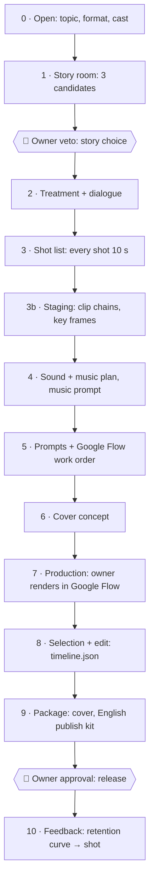
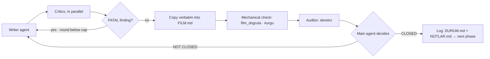

<h1 align="center">🎬 film_md</h1>

<p align="center">
  <b>An agentic, text-only production pipeline for AI sci-fi short films.</b><br>
  18 Claude Code sub-agents write, critique and gate every phase. A human renders in Google Flow and approves only two things: the story and the release.
</p>

<p align="center">
  
  
  
  
  
  
  
</p>

---

## Contents

- [What is this?](#what-is-this)
- [At a glance](#at-a-glance)
- [Why it exists](#why-it-exists)
- [How it works](#how-it-works)
- [The agent room](#the-agent-room)
- [Invariant rules](#invariant-rules)
- [Production rules every film follows](#production-rules-every-film-follows)
- [Quick start](#quick-start)
- [Command reference](#command-reference)
- [Repository layout](#repository-layout)
- [Research and evidence](#research-and-evidence)
- [QA archive and lessons](#qa-archive-and-lessons)
- [Film catalogue](#film-catalogue)
- [What the channel measured](#what-the-channel-measured)
- [Status and roadmap](#status-and-roadmap)
- [Contributing](#contributing)
- [Credits and license](#credits-and-license)

---

## What is this?

`film_md` is the working repository behind **Apex AI Cinema**, a YouTube channel of photoreal AI science-fiction short films. It turns a one-line idea into a publish-ready film plan through a fixed sequence of phases:

1. story → treatment → shot list → staging → sound and music → prompts → cover concept;
2. production in Google Flow, done by a human;
3. selection and edit → package → feedback.

The repository holds **text only**: plans, prompts, agent outputs, edit decisions (`timeline.json`), measurements and notes. Images, video and audio never enter git. They live in `~/film_medya/<FILM>/` on the operator's machine.

Think of it as a build system for films:

| Software build | `film_md` |
|---|---|
| source code | `FILM.md`, `PROMPTLAR/*.md` |
| compiler | Google Flow (Veo 3.1 · Gemini Omni Flash 1.1) |
| linter | `film_dogrula.py` |
| code review | critic sub-agents + auditor |
| CI | `test/kos.py` (36 regression tests) |
| release | the owner's publish approval |

> **Language note.** The method documents, agent definitions and notes are written in **Turkish**. Every prompt sent to a model, and every publish package (`YAYIN_PAKETI.md`), is in **English**.


---

## At a glance

Counted from the working tree on **12 October 2026**.

| What | Count |
|---|---|
| Film folders | **125**: 121 from the old pipeline, 4 from the new agentic pipeline |
| ├─ horizontal 2 min | 67 |
| ├─ horizontal 4 min | 30 |
| ├─ horizontal 8 min | 6 |
| ├─ horizontal 16 min | 3 |
| ├─ horizontal 32 min | 1 |
| └─ vertical Shorts | 18 |
| Markdown files | 3,119 (≈ 803,000 lines) |
| Raw QA reports (old pipeline) | 876 |
| Film QA reports (old pipeline) | 77 |
| Quality tables | 15 per-lens tables + 7 summary tables |
| Lessons | coded lessons up to D217 |
| Old-pipeline guides | 55 guide files (≈ 24,000 lines), frozen |
| New-pipeline method docs | 15 files in `uretim_hatti/` |
| Sub-agents | 18 (7 Opus · 11 Sonnet) |
| Skills | 15 (7 pipeline · 3 frozen · 5 third-party) |
| Python tools | 6 (≈ 1,760 lines, standard library + ffmpeg) |
| Regression tests | 36, with 13 sample film folders (text only) |
| Deep-research prompts | 25 in 5 sets, 25 raw answers, 5 digests |
| Channel (01.09.2026) | 225 videos · 3,210 subscribers · 486,630 views |

---

## Why it exists

The first pipeline was a rulebook. By 5 October 2026 it had produced:
- 121 film plans;
- 63 guides of about 27,000 lines;
- a 2,950-line prompt checker.

225 videos were published, yet no viewer data had been recorded for any of them.

An analysis of raw QA reports from 49 complete films showed where the fatal errors came from:

| Origin of fatal technical errors | Share |
|---|---|
| **What** the shot asked the model to show | ~45 % |
| The prompt **text** itself | ~17 % |

Writing more rules did not help. One example: a contact sentence was present in 22 of 25 prompts, and the films still had 7 fatal contact errors.

The new pipeline (since 5 October 2026) changes the approach:

- **Specialists write, other specialists critique.** No agent judges its own work.
- **A gate closes every phase.** Mechanical checks cannot be overridden. Judgement checks can, but only with a written reason.
- **A human chooses the footage.** The main agent never approves motion it cannot see.
- **An error does not become a rule.** The pipeline finds where the error was born and fixes it there. A pattern becomes a rule only after it repeats in two films, and only with the owner's approval.

---

## How it works

There is a single entry point: the **`/yeni-film`** skill in Claude Code. It starts a new film or resumes one from `ODA/DURUM.md`.



Every phase runs the same loop:



| Phase | Output | Writer | Critics | Gate |
|:--:|---|---|---|---|
| 1 | 3 story candidates | senarist | dramaturg · yonetmen · izleyici | main agent picks → **owner veto** |
| 2 | treatment, dialogue | senarist · diyalog-yazari | dramaturg · izleyici · ses-tasarimcisi | auditor → main agent |
| 3 | shot list | yonetmen | teknik-danisman · izleyici (text animatic) | film_dogrula + auditor |
| 3b | clip chains, key frames, floor plan | sahneleyici · mekan-haritacisi | teknik-danisman · yonetmen · izleyici | film_dogrula + auditor |
| 4 | sound layers, music plan, music prompt | ses-tasarimcisi · besteci | kurgucu · diyalog-yazari | auditor |
| 5 | reference, frame and video prompts + Flow work order | goruntu-yonetmeni (one per group, in parallel) | devamlilik · teknik-danisman | film_dogrula + auditor |
| 6 | 2–3 cover candidates | kapak-tasarimcisi | izleyici · yonetmen · yayin | main agent |
| 7 | renders in Google Flow (**owner**) | goruntu-yonetmeni (redesign) | devamlilik · zincir-bekcisi · izleyici · teknik-danisman | frame evidence only |
| 8 | selection, `timeline.json`, draft | kurgucu · besteci | izleyici · dramaturg | kurgu.py check + auditor |
| 9 | final cover, English publish kit | kapak-tasarimcisi · yayin | izleyici · bilim-danismani | **owner release approval** |
| 10 | retention feedback | — | — | notes only, never a new rule |

**Budget.** Each film has a ceiling of 50 sub-agent calls. After 40, only FATAL findings can open a new round.

**Two cheap tests before expensive video.** A text animatic in phase 3 and a frame animatic in phase 7c. If a viewer cannot follow the goal and the outcome, no video is rendered.

---

## The agent room

All agents live in `.claude/agents/`. None of them can spawn other agents. Write access is limited to the agents that author an artefact.

| Agent | Role | Model | Tools |
|---|---|:--:|---|
| `senarist` | story candidates, treatment | Opus | Read · Grep · Glob · Write |
| `dramaturg` | story critic: "why will this collapse?" | Opus | Read · Grep · Glob |
| `diyalog-yazari` | natural English dialogue, voice profiles | Opus | Read · Grep · Glob · Write |
| `yonetmen` | shot list: one piece of information per shot | Opus | Read · Grep · Glob · Write |
| `sahneleyici` | staging: which shots chain, key frames | Opus | Read · Grep · Glob · Write |
| `mekan-haritacisi` | floor plan, screen direction, physical feasibility | Sonnet | Read · Grep · Glob · Write |
| `teknik-danisman` | model-risk critic: hands, vacuum, text, identity drift | Sonnet | Read · Grep · Glob |
| `goruntu-yonetmeni` | English image and video prompts, Flow work order | Sonnet | Read · Grep · Glob · Write |
| `devamlilik` | continuity: identity sentence, light, side, frames | Sonnet | Read · Grep · Glob |
| `zincir-bekcisi` | visual check of clip-chain seams | Sonnet | Read · Grep · Glob |
| `ses-tasarimcisi` | sound layers, room tone, effects list | Sonnet | Read · Grep · Glob · Write |
| `besteci` | music plan and Flow Music prompt | Sonnet | Read · Grep · Glob · Write |
| `kurgucu` | selection, `timeline.json`, transitions | Sonnet | Read · Grep · Glob · Write |
| `kapak-tasarimcisi` | cover candidates, small-size checks | Opus | Read · Grep · Glob · Write |
| `yayin` | English publish package: titles, description, tags | Sonnet | Read · Grep · Glob · WebSearch · Write |
| `bilim-danismani` | verifies the physics claim on the web | Sonnet | Read · Grep · Glob · WebSearch · WebFetch |
| `izleyici` | **independent viewer**: sees only what is on screen | Sonnet | Read (hook-restricted) |
| `denetci` | process auditor: were the required checks done? | Opus | Read · Grep · Glob · Bash |

**The independent viewer is sandboxed.** A `PreToolUse` hook (`uretim_hatti/araclar/izleyici_kanca.py`) blocks `izleyici` from reading anything outside `~/film_medya/<FILM>/izleyici*/`. It cannot open the plan, so its confusion is real confusion.


---

## Invariant rules

From `AGENTS.md` §1. Every agent and tool obeys them.

1. **Only the owner commits.** `.claude/settings.json` denies `git commit`, `push`, `reset`, `checkout`, `stash` and `gh`.
2. **No media in the repo.** Images, video and audio stay in `~/film_medya/<FILM>/`. `.gitignore` blocks every image, video and audio extension.
3. **Nothing is deleted.** The old pipeline stays where it is. Guides and reports are not edited.
4. **An error does not become a rule.** It becomes a line in the film's `NOTLAR.md`. A rule needs two films and the owner's approval.
5. **Who approves what.**
   - The main agent closes phase gates using the auditor's report.
   - A mechanical ❌ cannot be overridden.
   - A judgement ❌ can be, with a written reason in `ODA/DURUM.md`.
6. **An AI score decides nothing.** A critique is evidence plus severity, never a grade.
7. **Raw output is kept.** Every agent output is stored in `ODA/` unchanged.
8. **Independent eyes.** Critics never receive the author's reasoning. The viewer never receives the plan.

---

## Production rules every film follows

Each rule below is an owner decision, enforced by an agent rule, an acceptance item or `film_dogrula.py`.

| Rule | Since | What it means |
|---|---|---|
| **Every shot is 10 s** | 08.10.2026 | Shot count = target length / 10: 2 min → 12, 4 min → 24, 8 min → 48, 16 min → 96. Rhythm comes from motion and scale inside the shot, not from cutting. |
| **Numbered references** | 10.10.2026 | One reference sheet per subject: `ref/<No>.<NAME>_v1.png`. Every image prompt names it as `Reference <No> (…)`. |
| **10 s beat plan** | 10.10.2026 | Every video prompt splits 10 s into 2–4 beats ("0-3 s … 3-7 s … 7-10 s"), each at least 2 s. The last beat never freezes. |
| **Model-voiced dialogue** | 12.10.2026 | Dialogue lines are written verbatim into the video prompt and the video model speaks them. Max 8 s per line, 5 s with the mouth in frame. |
| **Cut continuity** | 12.10.2026 | Three layers. Prompt: a shared look sentence in every prompt. Sound: one room-tone bed per location that runs across clips. Edit: a transition type per cut, rendered with `xfade`. |
| **Music prompt in every film** | 12.10.2026 | `FILM.md` §7 holds an English Flow Music prompt of at least 200 characters. |
| **First 30 seconds** | 12.10.2026 | C01 opens on a problem, in motion. A person appears by C02. The cover moment lands in C03. No logo, no black screen. The opening must read with the sound off. See `ILK_30_SANIYE_KILAVUZU.md`. |
| **Cover and title** | 12.10.2026 | One relationship and at most 3 people. 0–3 words on the cover, never the film title. Everything on the cover appears in the film. The safest candidate is uploaded first. See `KAPAK_VE_BASLIK_KILAVUZU.md`. |
| **Clip chains** | 05.10.2026 | Optional: up to 4 links per chain, built from real start and end frames. Never from "continue the previous clip" prompt language. |

---

## Quick start

### Requirements

| Need | Why |
|---|---|
| [Claude Code](https://claude.com/claude-code) | runs the main agent, the 18 sub-agents and the skills. The main model is set in `.claude/settings.json`. |
| Python 3 | the tools use only the standard library; Pillow is optional, for labelled contact sheets |
| ffmpeg + ffprobe | frames, seams, freeze and cut detection, `xfade`, loudness, cover checks |
| Google Flow | rendering: Veo 3.1 and Gemini Omni Flash 1.1. Omni's ingredients mode gives 10 s clips. |
| Flow Music | the film score, from the music prompt |
| Gemini app | in-clip and cross-cut QA scans (`uretim_hatti/QA_PROMPTLARI/`) |

### Install

```bash
git clone <this-repo> film_md
cd film_md
mkdir -p ~/film_medya                  # media workspace, outside git
python3 uretim_hatti/test/kos.py       # expect: 36/36 test geçti
```

### Make a film

```text
claude                                  # open Claude Code in the repo
> /yeni-film                            # asks 3 questions: topic · format/length · cast
```

The main agent then:
1. creates `<FORMAT>_filmler/<FILM>/` from `uretim_hatti/SABLON/` and the media tree under `~/film_medya/<FILM>/`;
2. runs phases 1–6, stopping once for your story veto;
3. at phase 7, hands you an exact Flow work order: which reference sheet, which frame, which prompt, in which order;
4. resumes with `/yeni-film` when you bring the renders back;
5. stops once more for your release approval.

---

## Command reference

All tools live in `uretim_hatti/araclar/`. Exit codes: `0` ok · `1` errors found · `2` usage.

### `film_dogrula.py`: structure linter

```bash
python3 uretim_hatti/araclar/film_dogrula.py <film-folder> [--bolum <section> …]
```

Sections are `kunye`, `hikaye`, `cekim`, `replik`, `sahneleme`, `prompt`, `muzik` and `durum`. They all run by default. `yayin` runs only on request.

The linter checks facts, never taste:
- 10 s shots and the shot count;
- required columns;
- numbered reference keys;
- the 10 s beat plan;
- verbatim model-voiced lines;
- the music-prompt block;
- the publish kit: character counts, exactly 3 hashtags, tags ≤ 500 characters, English only.

### `kurgu.py`: edit decisions → draft film

```bash
python3 uretim_hatti/araclar/kurgu.py kontrol   <timeline.json>
python3 uretim_hatti/araclar/kurgu.py liste     <timeline.json> [--zaman 01:23.5 | --kesmeler]
python3 uretim_hatti/araclar/kurgu.py taslak    <timeline.json> [-o draft.mp4]
python3 uretim_hatti/araclar/kurgu.py yukseklik <video> [--uygula -o final.mp4]
```

- `timeline.json` holds `parcalar`: clips with in and out points, an optional `gecis` transition, `klip_sesi` and a `zincir` chain id.
- It also holds `ses` (placed audio) and `yataklar` (per-location room-tone beds that run across clips).
- `yukseklik` targets −14 LUFS and ≤ −1 dBTP.

### `kareler.py`: frames the agents can "see"

```bash
python3 uretim_hatti/araclar/kareler.py cikar  <video> --hedef <dir> [--aralik 1.0] [--sayfa]
python3 uretim_hatti/araclar/kareler.py kucult <image> --boyut 160x90 --hedef <file>
python3 uretim_hatti/araclar/kareler.py kapak  <cover.png> --hedef <dir>
python3 uretim_hatti/araclar/kareler.py kare   <video> --t <sec|son> --hedef <png>
python3 uretim_hatti/araclar/kareler.py dikis  <clip_a> <clip_b | keyframe.png> --hedef <dir>
python3 uretim_hatti/araclar/kareler.py kuyruk <video>
```

| Command | Output |
|---|---|
| `cikar` | numbered frames + contact sheets |
| `kapak` | the cover at real surface sizes: 360×202, 168×94, 120×68 and grey. It also reports brightness, tone range, edge density and duration-badge corner flags, and warns under 1280×720. |
| `dikis` | a 4-frame strip, a difference image and SSIM/PSNR across a seam |
| `kuyruk` | freeze detection and hidden-cut detection |

### Other tools

```bash
python3 uretim_hatti/araclar/kor_ab.py karistir <files…> --hedef <dir>   # blind A/B: shuffle takes
python3 uretim_hatti/araclar/kor_ab.py ac <dir>                          # reveal after choosing
python3 uretim_hatti/araclar/ham_rapor_say.py [--ornek 3]                # count fatal rows in old QA reports
python3 uretim_hatti/test/kos.py [-v]                                    # all 36 regression tests
```


---

## Repository layout

```text
film_md/
├── AGENTS.md                    the agent contract: flow, rules, who approves what
├── CLAUDE.md                    entry note for Claude Code
├── AGENTS_ESKI_HAT.md           frozen map of the old pipeline (archive only)
├── .claude/
│   ├── settings.json            main model + git deny list
│   ├── agents/                  18 sub-agent definitions
│   └── skills/                  yeni-film · hikaye-odasi · sahneleme-odasi · ses-muzik ·
│                                cekim-yaz · klip-sec · paketleme (+ frozen and third-party skills)
├── uretim_hatti/                THE NEW PIPELINE
│   ├── README.md                method overview (Turkish)
│   ├── BILINEN_TUZAKLAR.md      proven traps: mandatory reading for writers and critics
│   ├── ARIZA_LISTESI.md         measured failures: story (H), technical (T), QA (Q)
│   ├── KABUL_LISTELERI.md       acceptance lists for every phase gate
│   ├── ELESTIRI_PROTOKOLU.md    critique format, severity, round rules
│   ├── FLOW_GERCEKLERI.md       Google Flow fact sheet: modes, lengths, credits, sound
│   ├── PROMPT_HATA_ATLASI.md    "don't write this → write this" atlas
│   ├── GOSTERIM_COZUMLERI.md    showing hard moments with framing, cuts and sound
│   ├── GECIS_VE_SES_SUREKLILIGI.md  cut and sound continuity
│   ├── ILK_30_SANIYE_KILAVUZU.md    first-30-seconds guide
│   ├── KAPAK_VE_BASLIK_KILAVUZU.md  cover and title guide
│   ├── IZLEYICI_VERISI.md       reading YouTube data after release
│   ├── QA_OKUMA_KILAVUZU.md     QA finding → time → shot → prompt → class
│   ├── SMOKE_TEST.md            Flow behaviour tests (owner runs them)
│   ├── AJAN_GOREVLERI.md        fixed task texts for sub-agents
│   ├── QA_PROMPTLARI/           Gemini scan prompts + human viewing form
│   ├── ARASTIRMA/               deep-research prompts · raw answers · digests
│   ├── SABLON/                  new-film template
│   ├── araclar/                 the 6 tools
│   └── test/                    kos.py + 13 text-only sample films
├── yatay_{2,4,8,16,32}_dk_filmler/   horizontal films by length
├── dikey_shorts_filmler/        vertical Shorts
├── kilavuzlar_ve_sistem_dosyalari/   old pipeline: guides, lessons, QA archive (frozen)
└── apexaic/                     channel operations: identity, external numbers, policy, publishing plan
```

**Anatomy of a new-pipeline film folder:**

```text
yatay_4_dk_filmler/THE_MAYDAY_SEA/
├── FILM.md            §1 story · §2 treatment · §3 visual identity · §4 shot list (+ opening table)
│                      §5 dialogue · §6 sound plan, room-tone beds, transitions · §7 music + MUSIC PROMPT
├── SAHNELEME.md       clip chains · key frames · floor plan · delta check
├── PROMPTLAR/G01.md…  per-group prompts + Flow work order
├── KAPAK_VE_YAYIN.md  cover candidates
├── YAYIN_PAKETI.md    English publish kit, ready to paste
├── ODA/               raw agent outputs F<phase>_<agent>_<round>.md + DURUM.md
├── NOTLAR.md          decisions · agent log · takes · rejections · scans
└── timeline.json      chosen seconds
```

**Media, outside git:**

```text
~/film_medya/<FILM>/
├── ref/       numbered reference sheets, one per subject
├── kare/      frames that go INTO Flow
├── ham/       Flow takes: Cxx_dN.mp4
├── ses/       dialogue · effects · room tone · music
├── cikti/     drafts · final · covers
├── analiz/    derived frames, scans, seams (never shown to the viewer agent)
└── izleyici/  the ONLY folder the viewer agent may read
```

---

## Research and evidence

The pipeline's rules come from three sources:
- the channel's own measurements;
- the old pipeline's QA archive;
- external deep research. Research is done with self-contained prompts and then digested claim by claim.

| Set | Topic | Raw answers | Digest |
|---|---|---|---|
| `01` | prompt, frame, sound and QA research | `ham/01-05` | `02_SUZME_20261006.md` |
| `03` | five new guides: error atlas, QA reading, Flow facts, hard moments, viewer data | `ham/06-10` | `04_SUZME_20261007.md`: 70 claims checked |
| `05` | YouTube 2026: monetisation, watch time, packaging, discovery, peer channels | `ham/11-15` | `06_SUZME_20261007.md`: 63 claims checked |
| `07` | the first 30 seconds | `ham/16-20` | `08_SUZME_20261012.md` → `ILK_30_SANIYE_KILAVUZU.md` |
| `09` | covers and titles | `ham/21-25` | `10_SUZME_20261012.md` → `KAPAK_VE_BASLIK_KILAVUZU.md` |

How the research works:
- **The test set stays hidden.** Each prompt comes with a hidden "test set" of the repo's own data. The research tool never sees it; the digest uses it to judge the answer.
- **Every claim gets a label:** ÖLÇÜLDÜ (measured: official page or verified study), UYGULAMA (practitioner) or HİPOTEZ (hypothesis). Only official pages and the studies themselves count as evidence.
- **Numbers are re-derived.** For example, the cover research claimed 1,500–2,500 impressions per cover are enough to compare two covers. The digest shows that telling 4 % from 5 % actually needs about 6,700 per cover.

---

## QA archive and lessons

The old pipeline's archive is frozen in `kilavuzlar_ve_sistem_dosyalari/`. Agents read it but never edit it.

| Asset | Size |
|---|---|
| `FILM_QA_RAPORLARI/02_HAM_RAPORLAR/` | 876 raw QA reports from 15 Gemini "lenses": frame, continuity, sound, story, background, physics, action, effort, framing, acting, light, hook, coherence, motion, direction |
| `FILM_QA_RAPORLARI/01_FILM_RAPORLARI/` | 77 film-level QA reports |
| Quality tables | T1–T15, one per lens, + story, logic, Shorts, character, sound, publish-performance and production-rejection tables |
| `FILM_QA_RAPORLARI/10_PROMPT_QA_ANALIZI/` | prompt × QA analysis: 31 films, 688 findings (19.09.2026) |
| `uretim_hatti/ARASTIRMA/qa_prompt_analizi_20261006/` | 12 films, ~300 raw reports, 698 unique findings; 56 % of real defects traced to the prompt |
| `DERSLER/` | coded lessons up to D217, in 13 files |
| Guides | 55 guide files, ≈ 24,000 lines, from opening scenes and story structure to space-suit design |

---

## Film catalogue

<details>
<summary><b>New agentic pipeline: 4 films</b></summary>

| Film | Format | State (12.10.2026) | Agent calls |
|---|---|---|---|
| THE_WRONG_BURN | horizontal 2 min · 12 shots | phase 7: rendering, owner | 50 / 50 |
| THE_FALSE_SUN | horizontal 2 min · 12 shots | phase 5 | 0 / 50 |
| THE_PLANET_THIEF | horizontal 4 min · 24 shots | phase 7: rendering, owner | 6 / 50 |
| THE_MAYDAY_SEA | horizontal 4 min · 24 shots, 18 model-voiced lines | phase 7: rendering, owner | 7 / 50 |

</details>

<details>
<summary><b>Horizontal 2 min: 67 folders</b></summary>

LOOK_UP · THE_ABANDONED_ARMADA · THE_AMBER_LATTICE · THE_BANDED_DEEP · THE_BENT_GRASS · THE_BLIND_RETURN · THE_BREATHING_STORM · THE_BRITTLE_EDGE · THE_BURNING_ENTRY · THE_BURNING_WORLD · THE_CANOPY_WORLD · THE_COLD_WELD · THE_CRACKED_HELMET · THE_DAWN_FRONT · THE_DEAD_APPROACH · THE_DEEP_PRESSURE · THE_DEEP_ROOT · THE_DRY_ANCHOR · THE_ETERNAL_DUSK · THE_ETERNAL_ENGINE · THE_FALSE_SUN · THE_FIRST_BREATH · THE_FORGOTTEN_ARCHITECTS · THE_GLASS_ABYSS · THE_GRAVITY_ANCHOR · THE_HEALING_GROUND · THE_HERD · THE_HOLDING_FIELD · THE_HOLLOW_COUNT · THE_HOLLOW_STATION · THE_INVERSION · THE_KALEIDA_CRASH · THE_LAST_ARCHIVE · THE_LAST_BLOOM · THE_LAST_CROSSING · THE_LAST_SHIFT · THE_LEANING_ROOM · THE_LISTENING_WORLD · THE_MAGNETIC_TIDE · THE_MIRROR_FAUNA · THE_ORPHAN_BLOOM · THE_PRESSED_FIELD · THE_PULSE · THE_REMEMBERING_DUST · THE_RESONANCE_FIELD · THE_RESONANT_STRAND · THE_RING_LIGHT · THE_RING_WALKER · THE_ROSE_COAT · THE_SHADOW_LINE · THE_SHATTERED_BREATH · THE_SILENT_EVENT_HORIZON · THE_SILENT_PERIHELION · THE_SLOW_TIDE · THE_SOLAR_MIRROR · THE_SPAGHETTI_TIDAL · THE_STARLESS_CIRCLE · THE_STATIC_SHADOW · THE_STATIC_VEIL · THE_STILL_SWARM · THE_STONE_SKY · THE_TALL_SHORE · THE_TETHERED_MASS · THE_TIDAL_HUNT · THE_UNBROKEN_CITY · THE_WRONG_BURN · WHITE_SILENCE

</details>

<details>
<summary><b>Horizontal 4 min: 30 folders</b></summary>

BLIND_ORBIT · GUNES_MEZARI · LOSS_OF_LIFT · LOW_POWER · THE_BLACK_CRADLE · THE_BLUE_DRIFT · THE_BORROWED_WEIGHT · THE_COLD_BURN · THE_COUNTED_RIVET · THE_COUNTED_TURN · THE_FROST_LINE · THE_GREEN_CEILING · THE_HARD_DOCK · THE_INWARD_FALL · THE_KEPT_LIGHT · THE_LOCKED_PULSE · THE_MAYDAY_SEA · THE_OPEN_CIRCUIT · THE_PAYLOAD · THE_PLANET_THIEF · THE_RISING_SNOW · THE_SIGNAL_KEEPERS · THE_SINKING_STAKE · THE_SKYLIGHT · THE_STANDING_WIRE · THE_STILL_POINT · THE_THIRD_DUNE · THE_UPHILL_DARK · THE_UPWARD_FALL · THE_WHITE_FLOOD

</details>

<details>
<summary><b>Horizontal 8 / 16 / 32 min: 10 folders</b></summary>

- **8 min:** BENI_HATIRLAMA · KRONOS_SON_SINYAL · SUSMAYAN_NOBETCI · THE_FALLING_WORLD · THE_LAST_TOW · THE_SLOW_RAIN
- **16 min:** THE_LAST_GATE · THE_SINKING_HARBOR · THE_STOLEN_SKY
- **32 min:** THE_FALSE_EARTH (192 clips, 50 scenes)

</details>

<details>
<summary><b>Vertical Shorts: 18 folders</b></summary>

NINE_MINUTES · THE_BRIGHT_TETHER · THE_DULL_EDGE · THE_FIRST_MORNING · THE_HALF_SKY · THE_HEAVY_SIDE · THE_IRON_SLOPE · THE_LOW_MOON · THE_NEAR_PASS · THE_OPEN_SEAM · THE_QUIET_IMPACT · THE_SINKING_HOUR · THE_SLOW_STONE · THE_SLOW_TIDE · THE_THIN_ROOF · THE_WALKING_DAY · THE_WINTER_LINE · THE_WRONG_SHADOW

</details>


---

## What the channel measured

These are the first real viewer numbers the pipeline uses. Each one comes from the owner's YouTube Studio.

**Retention at 30 seconds** ("Intro" in Studio, 12.10.2026):

| Video | Still watching at 0:30 |
|---|---|
| THE_INWARD_FALL | 51 % |
| THE_OLD_ROAD | 17 % |
| THE_STILL_POINT | 16 % |

**Click-through rate by surface** (12.10.2026):

| Surface | Share of impressions | Click-through rate |
|---|---|---|
| Suggested videos | ≈ 60 % | 2.39 % |
| Home | — | 4.42 % |
| Search | — | 3.76 % |

The two films with the 51 % and 16 % openings differ in three planned ways:
- **cover moment:** at 0:20 versus about 2:50;
- **first person on screen:** at 10 s versus 20 s;
- **visible defect:** a watermark from frame 0 in the weaker film.

These three differences are the pipeline's open hypotheses. Each new film records them in a one-variable experiment log (`IZLEYICI_VERISI.md` §3b).

---

## Status and roadmap

- [x] New agentic pipeline: 18 agents, phase gates, auditor, budget
- [x] Linter, edit tool, frame tool, blind A/B, 36 regression tests
- [x] Model-voiced dialogue, cut continuity, music prompt, first-30-seconds and cover guides
- [ ] Flow smoke tests run by the owner: the 10 s path (P14), model voice (P18), clip chains
- [ ] First new-pipeline film rendered and published end to end
- [ ] Dialogue-free M&E (music + effects) export in `kurgu.py`, for multi-language audio
- [ ] Retention and click-through data for every new film in the experiment log
- [ ] English translations of the method documents

---

## Contributing

1. Read `AGENTS.md` first. The eight invariant rules also apply to pull requests.
2. **Never add images, video or audio.** `.gitignore` blocks them. Describe media and measure it, but do not commit it.
3. **Do not edit frozen material.** That means `kilavuzlar_ve_sistem_dosyalari/`, `AGENTS_ESKI_HAT.md` and the old reports. Add new work next to them.
4. **Keep the tests green.** If you change a tool, run `python3 uretim_hatti/test/kos.py`. If an expected value changes, write the reason in `kos.py`.
5. **Rules need evidence.** A new rule needs a recorded case in two films, and the owner decides.

---

## Credits and license

- Built with [Claude Code](https://claude.com/claude-code): a main agent plus 18 sub-agents.
- Rendering with Google Flow (Veo 3.1, Gemini Omni Flash 1.1) and Flow Music. QA scans with Gemini.
- **Third-party skills** in `.claude/skills/`, listed with hashes in `skills-lock.json`:
  - `ab-testing`, `content-strategy` and `social` come from [coreyhaines31/marketingskills](https://github.com/coreyhaines31/marketingskills);
  - `image` and `video` come from [smixs/visual-skills](https://github.com/smixs/visual-skills).

  They keep their own licenses.
- **License:** not chosen yet. Until a `LICENSE` file is added, all rights are reserved by the repository owner.

<p align="center"><sub>Λ · Apex AI Cinema</sub></p>
