<div align="center">

<p align="center">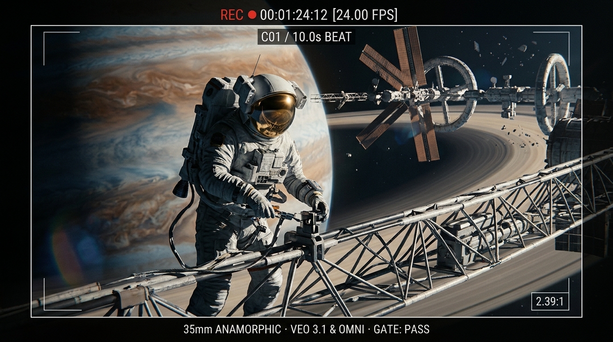</p>

<p align="center"></p>

# 🎬 film_md

**An agentic, text-only production pipeline for photoreal AI sci-fi short films.**<br>
**Fotorealistik yapay zekâ bilimkurgu kısa filmleri için metin-tabanlı, çok-ajanlı üretim hattı.**

<p align="center">
  <a href="https://github.com/Burak1320demiroz/film_md/actions"></a>
  <a href="CHANGELOG.md"></a>
  
  
  
  
  
  <a href="LICENSE"></a>
</p>

[🇬🇧 English](#-english) · [🇹🇷 Türkçe](#-türkçe) · [🎬 Film catalog / Film kataloğu](#-film-catalog--film-kataloğu) · [📝 Changelog](CHANGELOG.md)

</div>

---

> 📸 **Snapshot / Anlık görüntü — 22.10.2026.** Verified from the live repository tree. All 46 regression tests pass (`python3 uretim_hatti/test/kos.py`).
> The repository's own rule is *"a number lives in one place"* — for live numbers, run the tools.
> Bu README'deki her sayı canlı depo ağacından doğrulanmıştır. Depo kuralı *"sayı tek yerde durur"*: güncel sayılar için araçları çalıştırın.

---

# 🇬🇧 English

## Contents

- [1. What is this?](#1-what-is-this)
- [2. At a glance](#2-at-a-glance)
- [3. Why it exists & Pipeline v2](#3-why-it-exists--pipeline-v2)
- [4. Production rules every film follows](#4-production-rules-every-film-follows)
- [5. How it works](#5-how-it-works)
- [6. The agent room](#6-the-agent-room)
- [7. Invariant rules](#7-invariant-rules)
- [8. Quick start](#8-quick-start)
- [9. Command reference](#9-command-reference)
- [10. Repository layout & Film anatomy](#10-repository-layout--film-anatomy)
- [11. The production manual library](#11-the-production-manual-library)
- [12. Research and evidence](#12-research-and-evidence)
- [13. What the channel measured](#13-what-the-channel-measured)
- [14. Status and roadmap](#14-status-and-roadmap)
- [15. Contributing](#15-contributing)
- [16. Credits and license](#16-credits-and-license)

---

## 1. What is this?

`film_md` is the working repository behind **Apex AI Cinema**, a YouTube channel of photoreal AI science-fiction short films. It turns a one-line idea into a publish-ready film plan through a fixed sequence of phases:

1. **Story room → Treatment → Shot list → Staging → Sound & Music → Prompts → Cover concept**;
2. **Production in Google Flow (Veo 3.1 & Gemini Omni Flash 1.1)**, rendered by a human operator;
3. **Selection & Edit (`timeline.json`) → Publish kit → Audience retention feedback**.

The repository holds **text only**: plans, prompts, agent outputs, edit decisions, measurements, and post-mortems. Images, video, and audio never enter git. They reside in `~/film_medya/<FILM>/` on the operator's workstation.

Think of it as a build system for cinema:

| Software build | `film_md` |
|---|---|
| Source code | `FILM.md`, `PROMPTLAR/*.md` |
| Compiler | Google Flow (Veo 3.1 · Gemini Omni Flash 1.1) |
| Linter | `film_dogrula.py` (structure, beat lengths, model voices) |
| Code review | Critic sub-agents + Auditor (`denetci`) |
| CI / Tests | `test/kos.py` (46 automated regression tests) |
| Release | Owner's publish approval (`YAYIN_PAKETI.md`) |

<p align="center">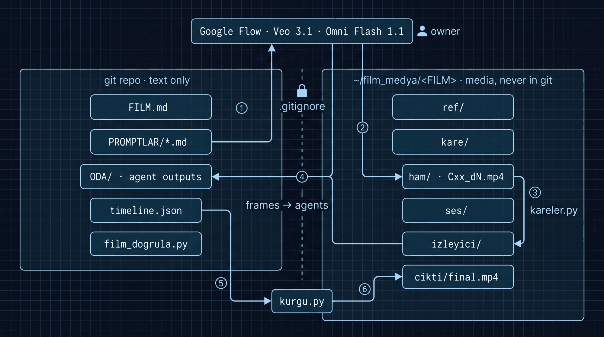</p>

> **Language note.** Method documents, agent definitions, and analytical notes are written in **Turkish**. Every prompt sent to a generative model, and every release package (`YAYIN_PAKETI.md`), is strictly in **English**.

---

## 2. At a glance

Counted directly from the live tree on **22 October 2026**:

| What | Count | Source |
|---|---:|---|
| 🎬 Film folders | **125** | 121 old pipeline · 4 new agentic pipeline |
| ├─ Horizontal 2 min | 67 | `yatay_2_dk_filmler/` |
| ├─ Horizontal 4 min | 30 | `yatay_4_dk_filmler/` |
| ├─ Horizontal 8 min | 6 | `yatay_8_dk_filmler/` |
| ├─ Horizontal 16 min | 3 | `yatay_16_dk_filmler/` |
| ├─ Horizontal 32 min | 1 | `yatay_32_dk_filmler/` (192 clips, 50 scenes) |
| └─ Vertical Shorts | 18 | `dikey_shorts/` |
| 📝 Markdown files | 3,119 (≈ 803,000 lines) | repo-wide |
| 📊 Raw QA reports (old pipeline) | 876 | 15 Gemini lenses |
| 🔍 Film QA reports (old pipeline) | 77 | `kilavuzlar_ve_sistem_dosyalari/` |
| 🧪 Measured lessons | coded lessons up to D217 | `DERSLER/` |
| 🤖 Sub-agents | 18 (7 Opus · 11 Sonnet) | `.claude/agents/` |
| ⚡ Skills | 15 (7 pipeline · 3 frozen · 5 third-party) | `.claude/skills/` |
| 🛠️ Python tools | 7 (≈ 2,100 lines, standard library + ffmpeg) | `uretim_hatti/araclar/` |
| 🧪 Regression tests | **46 / 46 passing** | `uretim_hatti/test/kos.py` |
| 🔬 Deep-research sets | 25 prompts in 5 sets, 25 raw answers, 5 digests | `uretim_hatti/ARASTIRMA/` |
| 📺 YouTube channel (measured) | 225 videos · 3,210 subscribers · 486,630 views | `uretim_hatti/KANAL/` |

---

## 3. Why it exists & Pipeline v2

The first pipeline was a rulebook. By 5 October 2026, it had produced 121 film plans, 63 guides (~27,000 lines), and a 2,950-line prompt checker script. 225 videos were published on YouTube, yet no viewer retention data had been recorded.

An exhaustive analysis of raw QA reports from 49 complete films revealed where fatal defects were truly born:

| Origin of fatal technical errors | Share | Cause |
|---|---:|---|
| **What** the shot asked the model to show | ~45 % | Unphysical actions, complex human-object contact |
| The prompt **text** phrasing | ~17 % | Ambiguous adjectives, leaking negative words |
| Physical & lighting contradictions | ~38 % | Camera jump, missing room tone, inconsistent references |

Writing more rules failed: *a contact sentence was explicitly written in 22 of 25 prompts, yet the rendered films still suffered 7 fatal contact errors.*

### Pipeline v2: Evidence over Rulebooks

In Pipeline v2 (updated 16 October 2026), error handling was radically restructured:
- **Specialists write, independent specialists critique:** No agent ever grades or reviews its own output.
- **Delivery ownership (Fable):** The lead agent reads progress from disk files via `medya.py`, not ephemeral memory.
- **F3p Early Pilot Phase:** 1–3 critical shots (opening hook, risky physics, character face) are rendered before writing prompts for the entire film.
- **Failures do not become rules:** Errors become film-specific notes (`NOTLAR.md`). Only recurring patterns appearing across multiple films with documented evidence become pipeline hypotheses.

### Why this approach? (Comparison)

| Dimension | Ad-Hoc Generative Prompting | Traditional Screenwriting | `film_md` (Docs-as-Code Cinema) |
|---|:---:|:---:|:---:|
| **Continuity across cuts** | ❌ Prompt by eye; lighting & scale jump wildly | — | ✅ **3-Layer Continuity** (common look + room tone bed + edit cuts) |
| **Character & asset identity** | ❌ Faces drift, suits change every take | — | ✅ **Single Reference Sheet** (4-view turnaround panel per subject) |
| **Temporal & beat rhythm** | ❌ Unpredictable clip lengths (4–8s) | ⚠️ Estimated scene minutes | ✅ **Deterministic 10s Shots** (2–4 beat temporal plan, no freeze) |
| **Dialogue integration** | ❌ Post-dubbing or robotic TTS overdub | ⚠️ Text script only | ✅ **In-Video Model Speech** (Omni Flash speech & lip-sync directly generated) |
| **Cost & credit protection** | ❌ Burning video credits on blind takes | — | ✅ **Two Cheap Gating Tests** (text animatic F3 & frame animatic F7c) |
| **Audit & review process** | ❌ Ad-hoc notes in Discord / web UIs | ⚠️ Manual review tracking | ✅ **18 Specialized Agents** with automated gate linters (`film_dogrula`) |
| **Version control & diffs** | ❌ Untracked prompt history | ⚠️ File versions (`v2_final_final.pdf`) | ✅ **Git-backed docs-as-code** with exact line-by-line diffs |

<p align="center">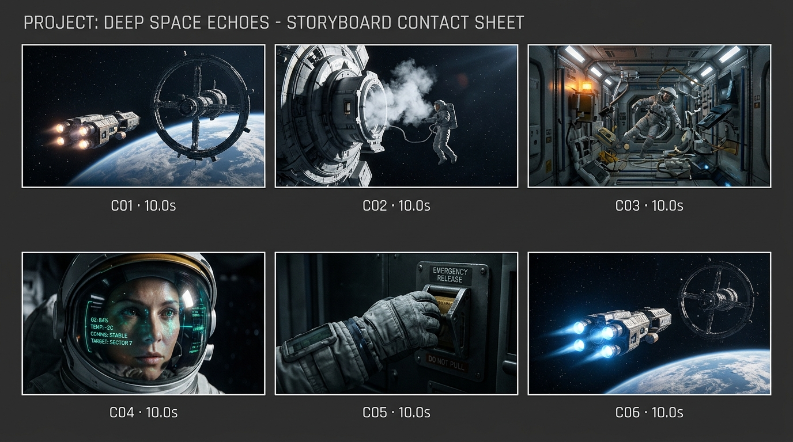</p>

---

## 4. Production rules every film follows

Every film in the agentic pipeline follows strict, machine-verified production invariants:

<p align="center">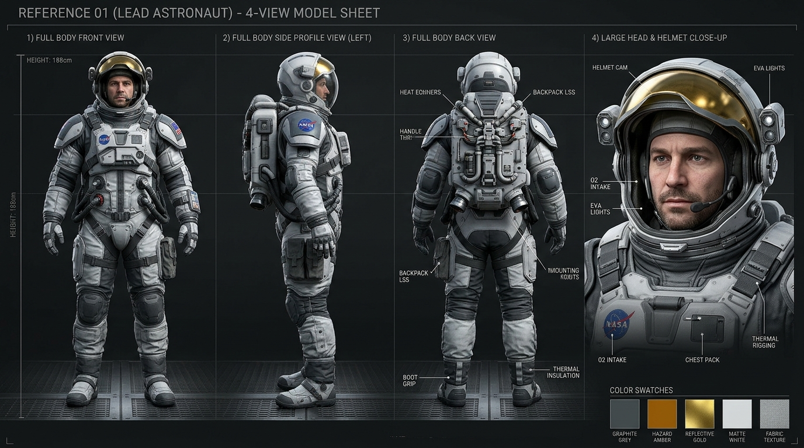</p>

### 1. Single Reference Sheet per Subject (`ref/<No>.<NAME>_v1.png`)
Each subject (character, spacecraft, or station) is defined on **one single visual turnaround sheet** showing 4 angles: front view, side profile, rear view, and helmet/face close-up. No separate "face-only" files are permitted. Every prompt addresses it as `Reference <No> (<role>)`.

### 2. Every Shot is Exactly 10 Seconds (Split into 2–4 Beats)
Total shot count is deterministically fixed to target duration:
- **2 min** = 12 shots · **4 min** = 24 shots · **8 min** = 48 shots · **16 min** = 96 shots.
Each 10-second shot prompt contains a continuous 2–4 beat temporal plan (`0-3s ... 3-7s ... 7-10s`). Each beat lasts at least 2 seconds, and the final beat never freezes.

### 3. Model-Voiced Dialogue (Generated Inside Video)
Dialogue is never dubbed over a silent render. Lines are written verbatim into the video prompt, and Google Flow (Omni Flash 1.1) synthesizes the speech and lip sync inside the video clip. Maximum 8 seconds per line (5 seconds when the speaker's mouth is on screen).

<p align="center">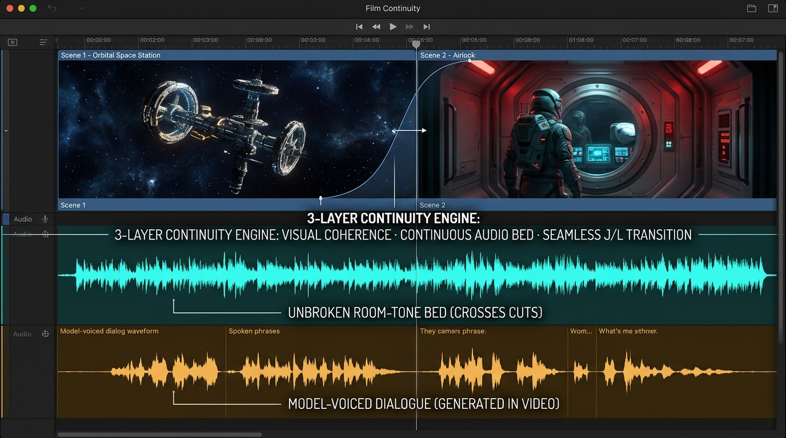</p>

### 4. Three-Layer Cut Continuity
Abrupt cuts and jarring audio shifts are eliminated by three synchronized layers:
1. **Visual:** Shared visual identity sentences and light continuity across shots.
2. **Sound:** An unbroken location room-tone bed (`yataklar`) that flows across clip boundaries without cutting.
3. **Edit:** Defined cut transitions (hard cut, 0.3–0.8s `xfade`, or 0.5–1.5s fade to black) rendered via `kurgu.py`.

---

## 5. How it works

The entire production cycle is initiated through a single entry point: `/yeni-film` in Claude Code.

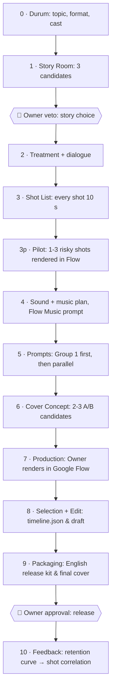

### The Phase Loop

Every phase executes an unyielding, standardized validation loop:

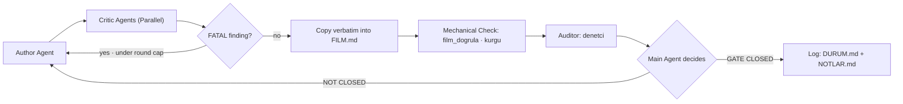

**Cheap tests before expensive renders:**
1. *Text animatic* in phase 3: tests whether goal and action read clearly from text alone.
2. *Frame animatic* in phase 7c: tests visual clarity using still frames before burning credits on video.

---

## 6. The agent room

All sub-agents live in `.claude/agents/`. No sub-agent can spawn other agents. Writing is strictly restricted to designated author roles.

| Role | Sub-agent | Model | Primary Responsibility |
|---|---|:--:|---|
| **Producer** | `fable` (Main Agent) | Claude | Orchestration, phase gates, disk-state delivery tracking |
| **Story** | `senarist` | Opus | 3 story candidates, scene treatment |
| | `dramaturg` | Opus | Structural critic: "why will this story collapse?" |
| | `diyalog-yazari` | Opus | Natural dialogue, authentic character voices |
| **Director** | `yonetmen` | Opus | Shot list, 10s beat structure, camera movement |
| | `sahneleyici` | Opus | Staging, clip chains, keyframe anchoring (when chains active) |
| | `mekan-haritacisi` | Sonnet | Spatial feasibility, screen direction, camera geometry |
| **Visuals** | `goruntu-yonetmeni` | Sonnet | Reference turnaround prompts, frame prompts, Flow work orders |
| | `devamlilik` | Sonnet | Continuity critic: lighting, side-of-action, suit identity |
| **Sound** | `ses-tasarimcisi` | Sonnet | Room-tone beds, Foley layers, audio transition plan |
| | `besteci` | Sonnet | Cinematic score plan, Flow Music prompt |
| **Edit** | `kurgu.py` / `kurgucu` | Sonnet | Take selection, `timeline.json`, transitions, loudness mastering |
| **Packaging**| `kapak-tasarimcisi` | Opus | Thumbnail composition, 160x90 readability tests |
| | `yayin` | Sonnet | English SEO publish kit (titles, description, tags) |
| | `bilim-danismani` | Sonnet | Hard sci-fi physics and planetary science fact-checking |
| **Blind QA** | `izleyici` | Sonnet | **Sandboxed viewer**: sees only rendered screen frames |
| **Process** | `denetci` | Opus | Process auditor: checks acceptance lists and linters |

<p align="center">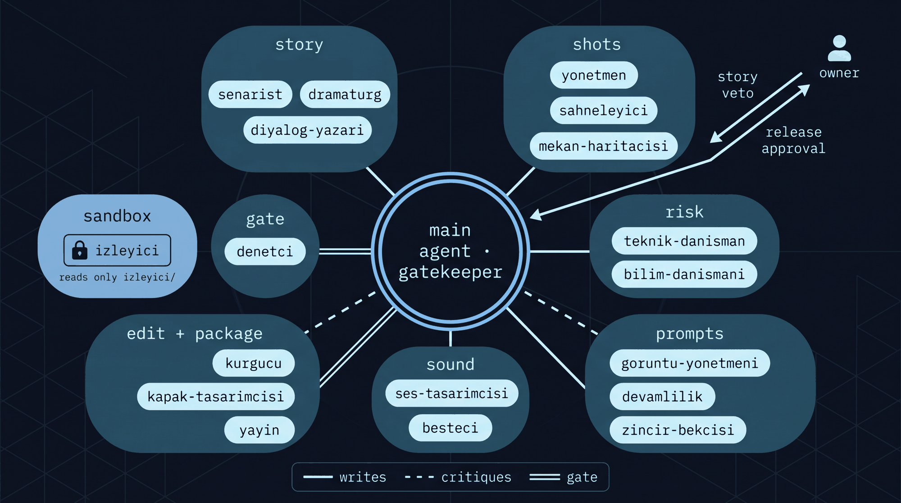</p>

**The Independent Viewer is Sandboxed:**
A `PreToolUse` hook script (`uretim_hatti/araclar/izleyici_kanca.py`) prevents the `izleyici` agent from reading any file outside `~/film_medya/<FILM>/izleyici*/`. It cannot read the script, the shot list, or the author's intentions. Its confusion is genuine viewer confusion.

---

## 7. Invariant rules

From `AGENTS.md` §1 — enforced across all agents, tools, and operators:

1. **Only the human owner commits.** Git commit, push, reset, checkout, and stash are permanently blocked in `.claude/settings.json`.
2. **No media in git.** Images, video, and audio reside in `~/film_medya/<FILM>/`. The `.gitignore` rejects all media extensions (sole exception: `images/readme_*.png` for documentation).
3. **Nothing is deleted.** The old pipeline, guides, and reports remain frozen as historical ground truth.
4. **An error does not become a rule.** A defect becomes a note in `NOTLAR.md`. A pattern requires documented recurrence in two distinct films before entering `BILINEN_TUZAKLAR.md`.
5. **Approval authority:**
   - The main agent closes phase gates backed by the auditor's report.
   - Mechanical ❌ (linter failures, test breakages) **cannot be overridden**.
   - Judgement ❌ can be overridden with a written rationale logged in `DURUM.md`.
   - The owner holds two non-delegable gates: story veto (Phase 1) and release approval (Phase 9).
6. **AI scores decide nothing:** Critic reports provide verifiable findings (evidence + severity), never arbitrary ratings.

---

## 8. Quick start

### Prerequisites

| Dependency | Purpose |
|---|---|
| [Claude Code](https://claude.com/claude-code) | Runs the main orchestrator, sub-agents, and pipeline skills |
| Python 3 (stdlib) | Tool execution (`film_dogrula`, `kurgu`, `kareler`, `medya`) |
| ffmpeg & ffprobe | Frame extraction, seam stitching, LUFS loudness normalization, video cuts |
| Google Flow | Video generation: Veo 3.1 & Gemini Omni Flash 1.1 |
| Flow Music | Film score generation from text prompts |

### Setup

```bash
git clone <this-repo> film_md
cd film_md
mkdir -p ~/film_medya                  # media workspace, outside git
python3 uretim_hatti/test/kos.py       # expect: 46/46 test geçti
```

### Launching a Film

```bash
claude                                  # open Claude Code in the repo
> /yeni-film                            # prompts for: topic · format/length · cast
```

---

## 9. Command reference

All tools reside in `uretim_hatti/araclar/`.

<p align="center">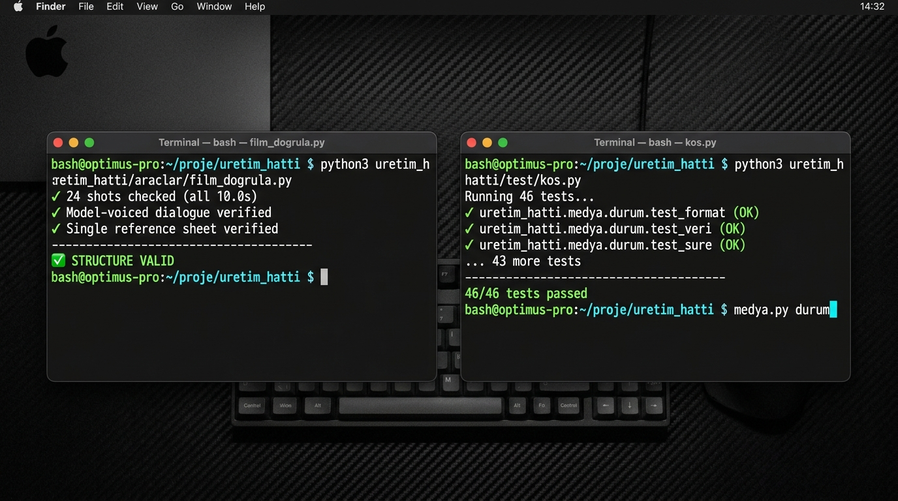</p>

### `film_dogrula.py` — Structural Linter
```bash
python3 uretim_hatti/araclar/film_dogrula.py <film-folder> [--bolum <section>]
```
Verifies facts, never creative choices:
- 10-second shot lengths and exact shot counts (`HEDEF_SURE / 10`).
- Required columns in `FILM.md`.
- Numbered reference keys matching single model sheets.
- 10-second beat plan (no frozen final beats).
- Verbatim model-voiced dialogue formatting.
- Flow Music prompt block (>= 200 characters).
- Release package formatting: exactly 3 hashtags, tags <= 500 characters, English only.

### `kurgu.py` — Edit Decision Engine & Audio Normalization
```bash
python3 uretim_hatti/araclar/kurgu.py kontrol   <timeline.json>
python3 uretim_hatti/araclar/kurgu.py liste     <timeline.json> [--zaman 01:23.5 | --kesmeler]
python3 uretim_hatti/araclar/kurgu.py taslak    <timeline.json> [-o draft.mp4]
python3 uretim_hatti/araclar/kurgu.py yukseklik <video.mp4> [--uygula -o final.mp4]
```
- Controls video cuts, audio beds (`yataklar`), and model dialogue tracks.
- Normalizes broadcast loudness to **-14.0 LUFS** and **<= -1.0 dBTP** true peak.

### `kareler.py` — Visual Inspection & Seam Analysis
```bash
python3 uretim_hatti/araclar/kareler.py cikar  <video> --hedef <dir> [--aralik 1.0] [--sayfa]
python3 uretim_hatti/araclar/kareler.py kapak  <cover.png> --hedef <dir>
python3 uretim_hatti/araclar/kareler.py dikis  <clip_a> <clip_b> --hedef <dir>
python3 uretim_hatti/araclar/kareler.py kuyruk <video>
```
- Extracts contact sheets for agent review.
- Tests YouTube thumbnail readability at 360x202, 168x94, 120x68, and grayscale.
- Measures SSIM/PSNR seam continuity across cuts.

### `medya.py` — Media Workspace & Production Ledger
```bash
python3 uretim_hatti/araclar/medya.py durum <FILM>
python3 uretim_hatti/araclar/medya.py al    <FILM> [--yaz]
python3 uretim_hatti/araclar/medya.py bol   <montaj.mp4> --film <FILM>
```
- Inspects real media files on disk and aligns `DURUM.md` with physical renders.
- Logs generation takes, prompts, inputs, and seeds into `NOTLAR.md`.

---

## 10. Repository layout & Film anatomy

```text
film_md/
├── AGENTS.md                    the agent contract: flow, rules, who approves what
├── CLAUDE.md                    developer instructions for Claude Code
├── AGENTS_ESKI_HAT.md           frozen map of the old pipeline (archive only)
├── .claude/
│   ├── settings.json            main model + git command deny list
│   ├── agents/                  18 sub-agent definitions
│   └── skills/                  yeni-film and specialized room skills
├── uretim_hatti/                THE AGENTIC PRODUCTION PIPELINE
│   ├── README.md                pipeline overview (Turkish)
│   ├── BILINEN_TUZAKLAR.md      empirically proven model traps
│   ├── ARIZA_LISTESI.md         measured defects: story (H), tech (T), QA (Q)
│   ├── KABUL_LISTELERI.md       phase gate criteria
│   ├── ELESTIRI_PROTOKOLU.md    critic format and severity rules
│   ├── FLOW_GERCEKLERI.md       Google Flow parameters, modes, credits, sound
│   ├── ILK_30_SANIYE_KILAVUZU.md first-30-seconds hook guide
│   ├── GECIS_VE_SES_SUREKLILIGI.md 3-layer cut continuity rules
│   ├── KAPAK_VE_BASLIK_KILAVUZU.md cover and title packaging guide
│   ├── IZLEYICI_VERISI.md       YouTube analytics reading protocol
│   ├── araclar/                 production tools: film_dogrula, kurgu, kareler, medya
│   └── test/                    kos.py + 46 regression test suites
├── yatay_{2,4,8,16,32}_dk_filmler/   horizontal films organized by length
└── kilavuzlar_ve_sistem_dosyalari/   frozen legacy guides, lessons, QA archive
```

**Anatomy of an active film directory:**

```text
yatay_4_dk_filmler/THE_MAYDAY_SEA/
├── FILM.md            §1 Story · §2 Treatment · §3 Visual Identity · §4 Shot List
│                      §5 Dialogue · §6 Sound & Transitions · §7 Music Prompt
├── SAHNELEME.md       Staging, camera geometry, floor plan
├── PROMPTLAR/G01.md…  Per-group prompts + Flow work order
├── KAPAK_VE_YAYIN.md  Cover candidates and packaging analysis
├── YAYIN_PAKETI.md    English release kit (ready for YouTube)
├── ODA/               Raw agent outputs (F<phase>_<agent>_<round>.md) + DURUM.md
├── NOTLAR.md          Decision log, take ledger, Gemini QA scans
└── timeline.json      Edit decision list, transitions, and audio beds
```

---

## 11. The production manual library

`film_md` is more than code—it is an **aerospace-grade operational library** of film production manuals, error atlases, and empirical field guides. With **18 active Hat v2 manuals in `uretim_hatti/`** and **55 archived specialized guides in `kilavuzlar_ve_sistem_dosyalari/` (~51,000 total lines)**, every artistic decision is governed by documented physical and model realities.

<p align="center">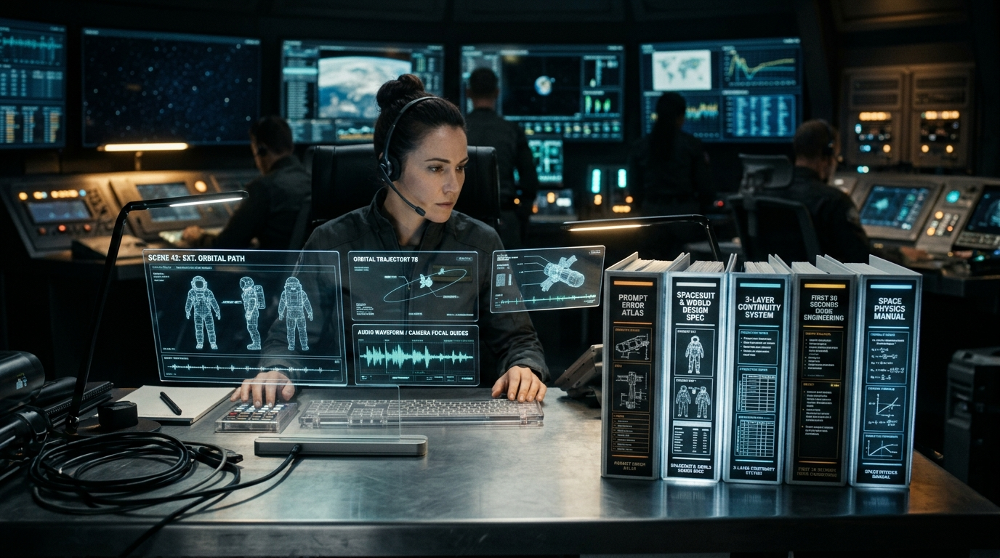</p>

| Category | Manual / Guide | Lines | Primary Problem It Solves |
|---|---|---:|---|
| **Prompt Engineering & Traps** | [`PROMPT_HATA_ATLASI.md`](uretim_hatti/PROMPT_HATA_ATLASI.md) | ~800 | 24+ proven generative anti-patterns ("Don't write this → Write this") |
| | [`BILINEN_TUZAKLAR.md`](uretim_hatti/BILINEN_TUZAKLAR.md) | ~250 | Catalog of fatal AI traps: liquid in vacuum, melting fingers, text leakage |
| | [`FLOW_GERCEKLERI.md`](uretim_hatti/FLOW_GERCEKLERI.md) | ~600 | Google Flow parameters, Veo 3.1 & Omni Flash 1.1 modes, credit burn rates |
| | [`GPT_IMAGE_OMNI_KILAVUZU.md`](uretim_hatti/GPT_IMAGE_OMNI_KILAVUZU.md) | ~900 | Omni Flash ingredients prompting, seed stability, visual anchor tokens |
| **World Building & Physics** | [`DUNYA_VE_TASARIM_KILAVUZU.md`](uretim_hatti/DUNYA_VE_TASARIM_KILAVUZU.md) | ~380 | Hard sci-fi station geometry, EVA suit anatomy, zero-g airlocks |
| | [`UZAY_FIZIGI_GORUNTU_KILAVUZU.md`](uretim_hatti/UZAY_FIZIGI_GORUNTU_KILAVUZU.md) | ~320 | True vacuum lighting (chiaroscuro), RCS thruster plumes, zero-g inertia |
| | [`KAMERA_VE_MEKAN_KILAVUZU.md`](uretim_hatti/KAMERA_VE_MEKAN_KILAVUZU.md) | ~350 | Anamorphic 35mm optical framing, 180° spatial axis, camera scale jumps |
| | [`KIMLIK_VE_REFERANS_KILAVUZU.md`](uretim_hatti/KIMLIK_VE_REFERANS_KILAVUZU.md) | ~300 | 4-view model turnaround sheets, seed anchors, suit wear states |
| **Acting, Script & Voice** | [`HIKAYE_YAPISI_KILAVUZU.md`](uretim_hatti/HIKAYE_YAPISI_KILAVUZU.md) | ~330 | Sci-fi premise, 3-act tension curves, two-character dilemma mechanics |
| | [`KARAKTER_VE_DIYALOG_KILAVUZU.md`](uretim_hatti/KARAKTER_VE_DIYALOG_KILAVUZU.md) | ~360 | Natural spoken English dialogue, comms radio cadence, micro-acting |
| | [`REPLIK_VE_KLIP_SESI_KILAVUZU.md`](uretim_hatti/REPLIK_VE_KLIP_SESI_KILAVUZU.md) | ~250 | In-video model-voiced lines, lip-sync framing, speech duration limits |
| | [`FRAGMAN_KILAVUZU.md`](uretim_hatti/FRAGMAN_KILAVUZU.md) | ~280 | Teaser & trailer production: spoiler gating, pacing, hook mechanics |
| **Editing & Audience Science** | [`GECIS_VE_SES_SUREKLILIGI.md`](uretim_hatti/GECIS_VE_SES_SUREKLILIGI.md) | ~320 | 3-layer cut continuity: visual match, continuous room tone beds, xfade |
| | [`KURGU_SES_VE_MUZIK_KILAVUZU.md`](uretim_hatti/KURGU_SES_VE_MUZIK_KILAVUZU.md) | ~200 | Flow Music score prompting, audio ducking, broadcast LUFS mastering |
| | [`ILK_30_SANIYE_KILAVUZU.md`](uretim_hatti/ILK_30_SANIYE_KILAVUZU.md) | ~380 | The First 30 Seconds rule: C01 problem → C02 human → C03 thumbnail hook |
| | [`KAPAK_VE_BASLIK_KILAVUZU.md`](uretim_hatti/KAPAK_VE_BASLIK_KILAVUZU.md) | ~400 | Thumbnail design, 160×90 mobile readability, title CTR psychology |
| | [`IZLEYICI_VERISI.md`](uretim_hatti/IZLEYICI_VERISI.md) | ~270 | Mapping YouTube Studio retention drop-offs directly back to shot IDs |

---

## 12. Research and evidence

The pipeline's rules are grounded in empirical evidence, not aesthetic opinions:
1. **Measured YouTube channel data** (audience retention curves, CTR).
2. **QA archive analysis** (876 raw reports across 49 completed films).
3. **Structured deep research** (25 prompts in 5 sets, claim-by-claim digests).

| Set | Topic | Digest | Output |
|---|---|---|---|
| `01` | Prompting, framing, and audio defects | `02_SUZME_20261006.md` | Core pipeline architecture |
| `03` | Error atlas, hard moments, Flow facts | `04_SUZME_20261007.md` | `PROMPT_HATA_ATLASI.md` |
| `05` | YouTube algorithms, watch time, packaging | `06_SUZME_20261007.md` | Channel release guidelines |
| `07` | The first 30 seconds retention | `08_SUZME_20261012.md` | `ILK_30_SANIYE_KILAVUZU.md` |
| `09` | Covers and title CTR mechanics | `10_SUZME_20261012.md` | `KAPAK_VE_BASLIK_KILAVUZU.md` |

---

## 13. What the channel measured

Every pacing and packaging rule in the pipeline originates from real YouTube Studio analytics:

<p align="center">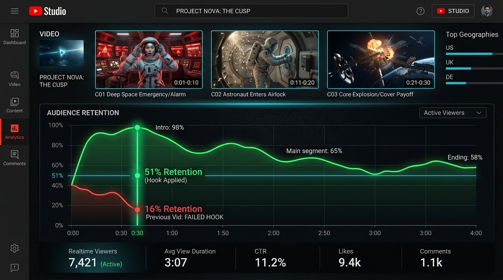</p>

**Retention at 30 Seconds ("Intro" in Studio, 12.10.2026):**

| Film | Hook Structure | Still Watching at 0:30 |
|---|---|:---:|
| **THE_INWARD_FALL** | C01 problem in motion · human at 10s · cover moment at 20s | **51 %** |
| **THE_OLD_ROAD** | Atmospheric opening · delayed human presence | **17 %** |
| **THE_STILL_POINT** | Slow landscape pan · corner artifact | **16 %** |

**The First 30 Seconds Rule:**
- **C01 (0–10s):** Must establish a concrete physical problem, already in motion.
- **C02 (10–20s):** Human protagonist must appear on screen by this shot.
- **C03 (20–30s):** The visual promise made on the thumbnail must be resolved or introduced.
- **No logos, no black screens, no title cards** during the first 30 seconds.
- The opening must read clearly even with audio muted.

---

## 14. Status and roadmap

- [x] Agentic pipeline: 18 Claude Code sub-agents, phase gating, budget caps.
- [x] Full CLI tool suite: `film_dogrula.py`, `kurgu.py`, `kareler.py`, `medya.py`.
- [x] **46 / 46 passing regression tests** (`uretim_hatti/test/kos.py`).
- [x] Model-voiced in-video dialogue and 3-layer cut continuity system.
- [x] F3p Pilot phase and single reference sheet turnaround rule.
- [ ] Render and publish the first complete Pipeline v2 film (*THE MAYDAY SEA*).
- [ ] Automated M&E (Music & Effects) dialogue-free export for international dubbing.
- [ ] Post-release retention tracker script correlating second-by-second drop-offs to shot IDs.

---

## 15. Contributing

1. **Read `AGENTS.md` before touching code:** The invariant rules apply to all pull requests.
2. **Never commit media:** `.gitignore` excludes all video, audio, and image assets.
3. **Never edit frozen archives:** `kilavuzlar_ve_sistem_dosyalari/` and old reports are read-only history.
4. **Keep tests green:** Every change must pass `python3 uretim_hatti/test/kos.py` (46 tests).
5. **Rules require evidence:** New pipeline rules require documented failure in at least two separate films and owner sign-off.

---

## 16. Credits and license

- **Orchestration:** Built with [Claude Code](https://claude.com/claude-code) (1 lead agent + 18 sub-agents).
- **Generative Engines:** Google Flow (Veo 3.1 & Gemini Omni Flash 1.1), Flow Music. QA scans via Google Gemini.
- **License:** [MIT](LICENSE) © 2026 Burak1320demiroz. Covers tools, agents, skills, guides, templates, and documentation.
- **Marks & Identity:** The license does not grant rights to the names *Apex AI Cinema* or *APEXAIC*, the Λ mark, or the channel logo (see [`THIRD_PARTY_NOTICES.md`](THIRD_PARTY_NOTICES.md)).

---

# 🇹🇷 Türkçe

## İçindekiler

- [1. Bu nedir?](#1-bu-nedir)
- [2. Bir bakışta](#2-bir-bakışta)
- [3. Neden var ve Hat v2](#3-neden-var-ve-hat-v2)
- [4. Her filmin uyduğu üretim kuralları](#4-her-filmin-uyduğu-üretim-kuralları)
- [5. Nasıl çalışır: Fazlar](#5-nasıl-çalışır-fazlar)
- [6. Ajan Odası](#6-ajan-odası)
- [7. Değişmez kurallar](#7-değişmez-kurallar)
- [8. Hızlı başlangıç](#8-hızlı-başlangıç)
- [9. Araçlar ve komut referansı](#9-araçlar-ve-komut-referansı)
- [10. Depo düzeni ve bir film klasörünün anatomisi](#10-depo-düzeni-ve-bir-film-klasörünün-anatomisi)
- [11. Üretim kılavuzları kütüphanesi](#11-üretim-kılavuzları-kütüphanesi)
- [12. Araştırma ve kanıt disiplini](#12-araştırma-ve-kanıt-disiplini)
- [13. Kanalın ölçtükleri: YouTube verisi ve ilk 30 saniye](#13-kanalın-ölçtükleri-youtube-verisi-ve-ilk-30-saniye)
- [14. Durum ve yol haritası](#14-durum-ve-yol-haritası)
- [15. Katkıda bulunma](#15-katkıda-bulunma)
- [16. Lisans ve künye](#16-lisans-ve-künye)

---

## 1. Bu nedir?

`film_md`, fotorealistik yapay zekâ bilimkurgu kısa filmleri yayınlayan **Apex AI Cinema** YouTube kanalının arkasındaki aktif üretim deposudur. Tek satırlık bir fikri, ardışık ve kapılı fazlar üzerinden yayına hazır bir film paketine dönüştürür:

1. **Hikâye Odası → Tretman → Çekim Listesi → Sahneleme → Ses ve Müzik → Promptlar → Kapak Konsepti**;
2. **Google Flow (Veo 3.1 ve Gemini Omni Flash 1.1)** üzerinde insan tarafından yapılan üretim;
3. **Seçim ve Kurgu (`timeline.json`) → Yayın Paketi → İzleyici Tutma Geri Beslemesi**.

Bu depoda **yalnızca METİN** bulunur: planlar, promptlar, ajan çıktıları, kurgu kararları, ölçümler ve notlar. Görsel, video ve ses dosyaları depoya asla girmez; operatörün yerel makinesinde `~/film_medya/<FILM>/` altında yaşar.

Sinema için bir derleme / build sistemi gibi çalışır:

| Yazılım derleme | `film_md` |
|---|---|
| Kaynak kod | `FILM.md`, `PROMPTLAR/*.md` |
| Derleyici (Compiler) | Google Flow (Veo 3.1 · Gemini Omni Flash 1.1) |
| Linter | `film_dogrula.py` (yapı, 10s vuruş planı, model sesi replik) |
| Kod inceleme (Review) | Eleştirmen alt ajanlar + Süreç Denetçisi (`denetci`) |
| Sürekli Entegrasyon (CI) | `test/kos.py` (46 regresyon testi) |
| Yayın (Release) | Kanal sahibinin yayın onayı (`YAYIN_PAKETI.md`) |

<p align="center"></p>

> **Dil Notu:** Yöntem belgeleri, ajan yönergeleri ve iç notlar **Türkçe** yazılmıştır. Üretim modellerine gönderilen tüm promptlar ve YouTube yayın paketi (`YAYIN_PAKETI.md`) ise **İngilizce**dir.

---

## 2. Bir bakışta

**22 Ekim 2026** itibarıyla canlı çalışma ağacından sayılmıştır:

| Ne | Sayı | Kaynak |
|---|---:|---|
| 🎬 Film klasörü | **125** | 121 eski hat · 4 yeni ajanlı hat |
| ├─ Yatay 2 dk | 67 | `yatay_2_dk_filmler/` |
| ├─ Yatay 4 dk | 30 | `yatay_4_dk_filmler/` |
| ├─ Yatay 8 dk | 6 | `yatay_8_dk_filmler/` |
| ├─ Yatay 16 dk | 3 | `yatay_16_dk_filmler/` |
| ├─ Yatay 32 dk | 1 | `yatay_32_dk_filmler/` (192 klip, 50 sahne) |
| └─ Dikey Shorts | 18 | `dikey_shorts/` |
| 📝 Markdown dosyası | 3.119 (≈ 803.000 satır) | depo geneli |
| 📊 Ham QA raporu (eski hat) | 876 | 15 Gemini merceği |
| 🔍 Film QA raporu (eski hat) | 77 | `kilavuzlar_ve_sistem_dosyalari/` |
| 🧪 Ölçülmüş ders | D217'ye kadar kodlanmış | `DERSLER/` |
| 🤖 Alt ajan | 18 (7 Opus · 11 Sonnet) | `.claude/agents/` |
| ⚡ Beceri (Skill) | 15 (7 hat · 3 dondurulmuş · 5 üçüncü taraf) | `.claude/skills/` |
| 🛠️ Python aracı | 7 (≈ 2.100 satır, standart kütüphane + ffmpeg) | `uretim_hatti/araclar/` |
| 🧪 Regresyon testi | **46 / 46 geçerli** | `uretim_hatti/test/kos.py` |
| 🔬 Derin araştırma | 5 sette 25 prompt, 25 ham yanıt, 5 süzme | `uretim_hatti/ARASTIRMA/` |
| 📺 YouTube kanalı (ölçülen) | 225 video · 3.210 abone · 486.630 izlenme | `uretim_hatti/KANAL/` |

---

## 3. Neden var ve Hat v2

İlk hat bir kural kitabıydı. 5 Ekim 2026'ya gelindiğinde 121 film planı, yaklaşık 27.000 satırlık 63 kılavuz ve 2.950 satırlık bir prompt denetleme betiği üretilmişti. Kanalda 225 video yayındaydı ancak hiçbir filmin izleyici verisi ölçülmemişti.

Tamamlanmış 49 filmin ham QA raporları incelendiğinde, ölümcül teknik kusurların asıl kaynakları ortaya çıktı:

| Ölümcül teknik hatanın doğduğu yer | Pay | Neden |
|---|---:|---|
| Çekimin modelden **ne göstermesini** istediği | ~%45 | Fizik dışı eylemler, karmaşık el-nesne temasları |
| Prompt **metninin** yazımı | ~%17 | Muğlak sıfatlar, prompta sızan olumsuz kelimeler |
| Fiziksel ve ışıksal çelişkiler | ~%38 | Kamera sıçraması, kesintili arka plan sesi, tutarsız referans |

Kural yazmak sonuç vermedi: *Temas cümlesi 25 promptun 22'sinde harfi harfine varken, filmlerde yine 7 ölümcül temas hatası yaşandı.*

### Hat v2: Kural Kitabı Değil, Ölçülen Kanıt

16 Ekim 2026'da devreye alınan Hat v2 ile hata yönetimi baştan kurgulandı:
- **Uzmanlar yazar, bağımsız uzmanlar eleştirir:** Hiçbir ajan kendi çıktısını denetlemez.
- **Teslimi ana ajan (Fable) sahiplenir:** Durum hafızadan değil, `medya.py durum` ile doğrudan diskteki dosyalardan okunur.
- **F3p Erken Pilot Fazı:** Tüm promptlar yazılmadan önce en riskli 1–3 çekim (açılış kancası, fizik riski, model sesi) gerçekten Flow'da üretilir.
- **Hata yeni kural doğurmaz:** Üretimde görülen hata filmin `NOTLAR.md`'sine işlenir. Yalnızca birden fazla filmde kayıtlı vakayla tekrar eden kusurlar hipotez haline gelir.

### Neden bu yaklaşım? (Karşılaştırma)

| Boyut | Doğaçlama AI Promptlama | Geleneksel Senaryo Yazımı | `film_md` (Docs-as-Code Sinema) |
|---|:---:|:---:|:---:|
| **Çekimler arası süreklilik** | ❌ Göz kararı prompt; ışık ve ölçek sıçrar | — | ✅ **3 Katmanlı Süreklilik** (ortak görünüm + ortam yatağı + kurgu) |
| **Karakter ve araç kimliği** | ❌ Her çekimde kayan yüzler ve kasklar | — | ✅ **Tek Referans Paneli** (özne başına 4 açılı model sayfası) |
| **Süre ve ritim disiplini** | ❌ Tahmin edilemeyen klip boyları (4–8s) | ⚠️ Tahmini sayfa/dakika hesabı | ✅ **Matematiksel 10s Çekim** (2–4 vuruş planı, son vuruş donmaz) |
| **Diyalog ve ses uyumu** | ❌ Sonradan dublaj veya ruhsuz TTS bindirme | ⚠️ Yalnızca metin | ✅ **Videoda Üretilen Model Sesi** (Omni dudak senkronlu konuşma) |
| **Maliyet ve kredi koruması** | ❌ Kör denemelerle pahalı kredi yakma | — | ✅ **İki Ucuz Kapı Testi** (metin animatiği F3 ve kare animatiği F7c) |
| **Denetim ve eleştiri süreci** | ❌ Discord/Web geçmişinde kaybolan notlar | ⚠️ Manuel notlar ve revizyon | ✅ **18 Uzman Alt Ajan** ve mekanik linter (`film_dogrula`) |
| **Sürüm takibi ve geçmiş** | ❌ Takipsiz prompt geçmişi | ⚠️ `senaryo_son_v3_final.pdf` | ✅ **Git tabanlı kod-belge** sistemi ve satır satır diff takibi |

<p align="center"></p>

---

## 4. Her filmin uyduğu üretim kuralları

Depodaki her film, kodla ve linter ile doğrulanan değişmez üretim ilkelerine uyar:

<p align="center"></p>

### 1. Özne Başına Tek Referans Sayfası (`ref/<No>.<AD>_v1.png`)
Her karakter veya araç tek bir panel görselinde tanımlanır: önden, yandan, arkadan görünüş ve yüz/kask yakını aynı görseldedir. "Sadece yüz" gibi ikincil referanslar yasaktır. Her prompt özneyi `Reference <No> (<rol>)` olarak çağırır.

### 2. Her Çekim Tam 10 Saniyedir (2–4 Vuruş Planı)
Çekim sayısı hedef süreye matematiksel olarak bağlıdır:
- **2 dk** = 12 çekim · **4 dk** = 24 çekim · **8 dk** = 48 çekim · **16 dk** = 96 çekim.
Her video promptu 10 saniyeyi 2–4 vuruşa böler (`0-3s ... 3-7s ... 7-10s`). Her vuruş en az 2 saniyedir ve son vuruş asla donmaz. Ritim kesmeyle değil, çekim içi hareketle kurulur.

### 3. Model Sesi Replik (Videoda Üretilen Konuşma)
Diyalog sonradan seslendirilmez. Replik doğrudan video promptuna yazılır ve Google Flow (Omni Flash 1.1) konuşmayı ve dudak senkronunu videonun kendi içinde üretir. Replik başına tavan 8 saniye (ağız kadrajdayken 5 saniye).

<p align="center"></p>

### 4. Üç Katmanlı Kesme Sürekliliği
Sert ve yapay geçişleri önlemek için üç katman birlikte yürütülür:
1. **Görüntü:** Promptta birebir tekrarlanan ortak görünüm ve ışık cümleleri.
2. **Ses:** Mekân başına tek bir kesintisiz oda tonu / ortam yatağı (`yataklar`), klipler arası kesilmeden akar.
3. **Kurgu:** Kesme başına tanımlanan geçiş türü (sert kesme, 0,3–0,8s `xfade` veya 0,5–1,5s karartma), `kurgu.py` ile işlenir.

---

## 5. Nasıl çalışır: Fazlar

Tüm üretim akışı Claude Code içinde tek bir komutla başlar: `/yeni-film`.

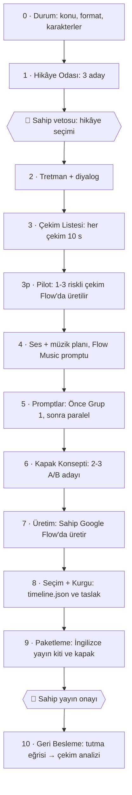

### Faz Döngüsü

Her faz standart, tavizsiz bir eleştiri ve kapı döngüsü işletir:

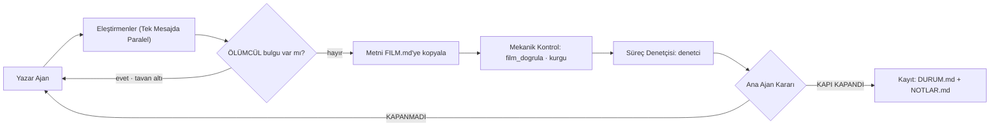

**Pahalı videodan önce iki ucuz test:**
1. *Metin animatiği* (Faz 3): Hikâye ve eylemin sadece metinden anlaşılıp anlaşılmadığını ölçer.
2. *Kareli animatik* (Faz 7c): Video üretimine kredi harcamadan önce hareketsiz başlangıç kareleriyle kurgu mantığını sınar.

---

## 6. Ajan Odası

Tüm alt ajanlar `.claude/agents/` dizinindedir. Hiçbir alt ajan başka bir ajan başlatamaz. Yazma yetkisi yalnızca üretici rollere verilmiştir.

| Rol | Alt Ajan | Model | Temel Görev |
|---|---|:--:|---|
| **Yapımcı** | `fable` (Ana Ajan) | Claude | Orkestrasyon, faz kapıları, disk üzerinden teslim takibi |
| **Hikâye** | `senarist` | Opus | 3 hikâye adayı, sahne sahne tretman |
| | `dramaturg` | Opus | Hikâye eleştirmeni: "Bu yapı nerede çöker?" |
| | `diyalog-yazari` | Opus | Doğal İngilizce diyaloglar, karakter ses profilleri |
| **Yönetmen** | `yonetmen` | Opus | Çekim listesi, 10s vuruş planı, kamera dili |
| | `sahneleyici` | Opus | Sahneleme, anahtar kareler, zincir halkaları (zincir açıkken) |
| | `mekan-haritacisi` | Sonnet | Fiziksel uygulanabilirlik, aks yönü, kamera geometrisi |
| **Görsel Üretim** | `goruntu-yonetmeni` | Sonnet | Referans ve kare promptları, Flow iş emirleri |
| | `devamlilik` | Sonnet | Süreklilik eleştirmeni: ışık, yön, kıyafet kimliği |
| **Ses & Müzik** | `ses-tasarimcisi` | Sonnet | Ortam yatakları, efekt katmanları, ses geçiş planı |
| | `besteci` | Sonnet | Müzik planı, Flow Music promptu |
| **Kurgu** | `kurgu.py` / `kurgucu`| Sonnet | Klip seçimi, `timeline.json`, geçişler, LUFS ses dengeleme |
| **Paketleme** | `kapak-tasarimcisi` | Opus | Kapak adayları, küçük boyut (160x90) okunabilirlik testi |
| | `yayin` | Sonnet | İngilizce yayın paketi (başlıklar, açıklama, etiketler) |
| | `bilim-danismani` | Sonnet | Sert bilimkurgu fizik ve astrofizik doğrulaması |
| **Bağımsız Göz** | `izleyici` | Sonnet | **Korumalı izleyici**: Sadece ekrandaki kareleri görür |
| **Süreç** | `denetci` | Opus | Süreç denetçisi: Kabul listelerini ve linterları doğrular |

<p align="center"></p>

**Bağımsız İzleyici Korumalıdır (Sandboxed):**
Bir `PreToolUse` kancası (`uretim_hatti/araclar/izleyici_kanca.py`), `izleyici` ajanının `~/film_medya/<FILM>/izleyici*/` klasörü dışındaki hiçbir dosyayı okumasına izin vermez. İzleyici planı, senaryoyu veya yönetmenin niyetini bilmez; kafa karışıklığı gerçek bir izleyicininkidir.

---

## 7. Değişmez kurallar

`AGENTS.md` §1'den — tüm ajanlar, araçlar ve yapımcı için bağlayıcıdır:

1. **Commit'i yalnız sahip atar:** `.claude/settings.json` içinde `git commit`, `push`, `reset`, `checkout` ve `stash` kesin olarak engellenmiştir.
2. **Medya repoya girmez:** Görseller, videolar ve sesler `~/film_medya/<FILM>/` altında durur. `.gitignore` tüm medya uzantılarını engeller (Tek istisna: dokümantasyon için `images/readme_*.png`).
3. **Hiçbir şey silinmez:** Eski hat, raporlar ve arşiv kılavuzları dondurulmuş olarak korunur.
4. **Hata kural olmaz:** Üretimde görülen kusur filmin `NOTLAR.md`'sine ret gerekçesi olur. Bir dersin genel kılavuza girmesi için en az iki ayrı filmde kayıtlı vaka gerekir.
5. **Onay yetkileri:**
   - Faz kapılarını Ana Ajan (`fable`), denetçinin raporuyla kapatır.
   - Mekanik ❌ (linter hataları, test kırılmaları) **asla aşılamaz**.
   - Yargı ❌'i yazılı gerekçeyle aşılabilir ve `DURUM.md`'ye işlenir.
   - Sahip iki kapıyı onaylar: Hikâye seçimi (veto) ve Yayın onayı.
6. **Yapay zekâ puanı karar vermez:** Eleştiri kanıt ve şiddet bildirir, asla soyut not/puan vermez.

---

## 8. Hızlı başlangıç

### Gereksinimler

| İhtiyaç | Neden |
|---|---|
| [Claude Code](https://claude.com/claude-code) | Ana ajanı, 18 alt ajanı ve faz becerilerini çalıştırır |
| Python 3 (standart) | Araçların çalışması (`film_dogrula`, `kurgu`, `kareler`, `medya`) |
| ffmpeg & ffprobe | Kare çıkarma, dikiş kontrolü, LUFS ses dengeleme, xfade geçişler |
| Google Flow | Video üretimi: Veo 3.1 ve Gemini Omni Flash 1.1 |
| Flow Music | Film müziklerinin metin promptundan üretimi |

### Kurulum

```bash
git clone <bu-repo> film_md
cd film_md
mkdir -p ~/film_medya                  # medya çalışma alanı, git dışında
python3 uretim_hatti/test/kos.py       # beklenen: 46/46 test geçti
```

### Film Başlatma

```bash
claude                                  # Claude Code'u depoda açın
> /yeni-film                            # 3 soru sorar: konu · format/süre · karakter
```

---

## 9. Araçlar ve komut referansı

Tüm araçlar `uretim_hatti/araclar/` dizinindedir.

<p align="center"></p>

### `film_dogrula.py` — Yapı ve Kural Denetçisi (Linter)
```bash
python3 uretim_hatti/araclar/film_dogrula.py <film-klasoru> [--bolum <bolum>]
```
Yaratıcılığı değil, teknik doğruları denetler:
- 10 saniyelik çekim süresi ve hedef süreye göre çekim sayısı (`HEDEF_SURE / 10`).
- `FILM.md` zorunlu sütunları.
- Numaralı referans anahtarları ve tek referans paneli kuralı.
- 10 saniyelik vuruş planı (son vuruş donmaz).
- Tırnak içinde, videoda üretilecek model sesi replikler.
- En az 200 karakterlik Flow Music prompt bloğu.
- Yayın paketi kuralları: tam 3 hashtag, etiketler <= 500 karakter, İngilizce metin.

### `kurgu.py` — Kurgu Karar Motoru ve Ses Dengeleme
```bash
python3 uretim_hatti/araclar/kurgu.py kontrol   <timeline.json>
python3 uretim_hatti/araclar/kurgu.py liste     <timeline.json> [--zaman 01:23.5 | --kesmeler]
python3 uretim_hatti/araclar/kurgu.py taslak    <timeline.json> [-o draft.mp4]
python3 uretim_hatti/araclar/kurgu.py yukseklik <video.mp4> [--uygula -o final.mp4]
```
- Klip giriş/çıkışlarını, ortam yataklarını (`yataklar`) ve model sesi replikleri birleştirir.
- Final sesini yayın standardı olan **-14,0 LUFS** ve **<= -1,0 dBTP** seviyesine dengeler.

### `kareler.py` — Görsel Denetim ve Dikiş Analizi
```bash
python3 uretim_hatti/araclar/kareler.py cikar  <video> --hedef <dizin> [--aralik 1.0] [--sayfa]
python3 uretim_hatti/araclar/kareler.py kapak  <kapak.png> --hedef <dizin>
python3 uretim_hatti/araclar/kareler.py dikis  <klip_a> <klip_b> --hedef <dizin>
python3 uretim_hatti/araclar/kareler.py kuyruk <video>
```
- Ajanların incelemesi için numaralı kareler ve kontak sayfaları üretir.
- Kapak görselini YouTube yüzeylerinde (360x202, 168x94, 120x68 ve gri tonlama) sınar.
- İki klip arasındaki kesmede SSIM/PSNR dikiş sürekliliğini ölçer.

### `medya.py` — Medya Takip ve Üretim Defteri
```bash
python3 uretim_hatti/araclar/medya.py durum <FILM>
python3 uretim_hatti/araclar/medya.py al    <FILM> [--yaz]
python3 uretim_hatti/araclar/medya.py bol   <montaj.mp4> --film <FILM>
```
- Diskteki gerçek medya dosyalarını tarar ve `DURUM.md`'yi fiziki üretime göre eşitler.
- Üretilen denemeleri, prompt özetlerini ve girdi karelerini `NOTLAR.md` tablosuna işler.

---

## 10. Depo düzeni ve bir film klasörünün anatomisi

```text
film_md/
├── AGENTS.md                    ajan kontratı: akış, kurallar, onay yetkileri
├── CLAUDE.md                    Claude Code başlangıç notu
├── AGENTS_ESKI_HAT.md           eski hattın dondurulmuş haritası (arşiv)
├── .claude/
│   ├── settings.json            ana model + git engelleme listesi
│   ├── agents/                  18 alt ajan tanımı
│   └── skills/                  yeni-film ve oda becerileri
├── uretim_hatti/                YENİ AJANLI ÜRETİM HATTI
│   ├── README.md                yöntem genel bakışı
│   ├── BILINEN_TUZAKLAR.md      kanıtlanmış model tuzakları
│   ├── ARIZA_LISTESI.md         ölçülmüş hatalar: hikâye (H), teknik (T), QA (Q)
│   ├── KABUL_LISTELERI.md       faz kapıları kabul listeleri
│   ├── ELESTIRI_PROTOKOLU.md    eleştiri formatı ve şiddet kuralları
│   ├── FLOW_GERCEKLERI.md       Google Flow modları, süreleri, kredileri, ses
│   ├── ILK_30_SANIYE_KILAVUZU.md ilk 30 saniye kanca kılavuzu
│   ├── GECIS_VE_SES_SUREKLILIGI.md 3 katmanlı kesme sürekliliği
│   ├── KAPAK_VE_BASLIK_KILAVUZU.md kapak ve başlık paketleme kılavuzu
│   ├── IZLEYICI_VERISI.md       YouTube izleyici verisi okuma protokolü
│   ├── araclar/                 üretim araçları: film_dogrula, kurgu, kareler, medya
│   └── test/                    kos.py + 46 regresyon testi
├── yatay_{2,4,8,16,32}_dk_filmler/   süreye göre ayrılmış yatay filmler
└── kilavuzlar_ve_sistem_dosyalari/   eski hat kılavuzları, dersler ve QA arşivi
```

**Aktif bir film klasörünün anatomisi:**

```text
yatay_4_dk_filmler/THE_MAYDAY_SEA/
├── FILM.md            §1 Hikâye · §2 Tretman · §3 Görsel Kimlik · §4 Çekim Listesi
│                      §5 Replikler · §6 Ses Yatakları ve Geçişler · §7 Müzik Promptu
├── SAHNELEME.md       Sahneleme, kamera açıları, mekân krokisi
├── PROMPTLAR/G01.md…  Grup bazlı promptlar ve Flow iş emirleri
├── KAPAK_VE_YAYIN.md  Kapak adayları ve yayın analizi
├── YAYIN_PAKETI.md    YouTube'a yapıştırılacak hazır İngilizce yayın kiti
├── ODA/               Ham ajan çıktıları (F<faz>_<ajan>_<tur>.md) + DURUM.md
├── NOTLAR.md          Karar kayıtları, deneme defteri, Gemini QA taramaları
└── timeline.json      Kurgu karar listesi, geçişler ve ses yatakları
```

---

## 11. Üretim kılavuzları kütüphanesi

`film_md` bir kod deposundan çok daha fazlasıdır: Film yapım kılavuzları, hata atlasları ve saha deneylerinden oluşan **havacılık-uzay disiplininde devasa bir metodoloji kütüphanesidir**. `uretim_hatti/` altında **18 aktif Hat v2 kılavuzu** ve `kilavuzlar_ve_sistem_dosyalari/` altında **55 dondurulmuş uzmanlık kılavuzu (toplam ~51.000 satır)** ile her sanatsal karar ölçülmüş fizik ve model gerçeklerine dayanır.

<p align="center"></p>

| Kategori | Kılavuz / Belge | Satır | Çözdüğü Temel Problem |
|---|---|---:|---|
| **Prompt Mühendisliği & Tuzaklar** | [`PROMPT_HATA_ATLASI.md`](uretim_hatti/PROMPT_HATA_ATLASI.md) | ~800 | 24+ kanıtlanmış model hatası ("Bunu yazma → Şunu yaz") |
| | [`BILINEN_TUZAKLAR.md`](uretim_hatti/BILINEN_TUZAKLAR.md) | ~250 | Ölümcül AI tuzakları: vakumda sıvı, eriyen parmaklar, prompttan sızan yazılar |
| | [`FLOW_GERCEKLERI.md`](uretim_hatti/FLOW_GERCEKLERI.md) | ~600 | Google Flow sınırları, Veo 3.1 & Omni Flash 1.1 modları, kredi tüketimi |
| | [`GPT_IMAGE_OMNI_KILAVUZU.md`](uretim_hatti/GPT_IMAGE_OMNI_KILAVUZU.md) | ~900 | Omni Flash ingredients modu, çekirdek (seed) kararlılığı, görsel anahtarlar |
| **Dünya Tasarımı & Uzay Fiziği** | [`DUNYA_VE_TASARIM_KILAVUZU.md`](uretim_hatti/DUNYA_VE_TASARIM_KILAVUZU.md) | ~380 | Sert bilimkurgu istasyon geometrisi, EVA astronot tulumu, sıfır-g hava kilidi |
| | [`UZAY_FIZIGI_GORUNTU_KILAVUZU.md`](uretim_hatti/UZAY_FIZIGI_GORUNTU_KILAVUZU.md) | ~320 | Gerçek vakum ışığı (chiaroscuro), RCS itki alevi, sıfır yerçekimi eylemsizliği |
| | [`KAMERA_VE_MEKAN_KILAVUZU.md`](uretim_hatti/KAMERA_VE_MEKAN_KILAVUZU.md) | ~350 | 35mm anamorfik lens kadrajı, 180° aks kuralı, kamera ölçek sıçramaları |
| | [`KIMLIK_VE_REFERANS_KILAVUZU.md`](uretim_hatti/KIMLIK_VE_REFERANS_KILAVUZU.md) | ~300 | 4 açılı model panelleri, referans sabitleme, kıyafet aşınma durumları |
| **Oyunculuk, Senaryo & Replik** | [`HIKAYE_YAPISI_KILAVUZU.md`](uretim_hatti/HIKAYE_YAPISI_KILAVUZU.md) | ~330 | Bilimkurgu önermesi, 3 perdeli gerilim eğrisi, iki kişilik çatışma dinamiği |
| | [`KARAKTER_VE_DIYALOG_KILAVUZU.md`](uretim_hatti/KARAKTER_VE_DIYALOG_KILAVUZU.md) | ~360 | Doğal konuşma İngilizcesi, telsiz ritmi, bedensel mikro hareketler |
| | [`REPLIK_VE_KLIP_SESI_KILAVUZU.md`](uretim_hatti/REPLIK_VE_KLIP_SESI_KILAVUZU.md) | ~250 | Videoda üretilen model sesi replikler, dudak senkronu kadrajı, replik süresi |
| | [`FRAGMAN_KILAVUZU.md`](uretim_hatti/FRAGMAN_KILAVUZU.md) | ~280 | Fragman ve teaser üretimi: spoiler denetimi, tempo, merak kancası |
| **Kurgu & İzleyici Mühendisliği** | [`GECIS_VE_SES_SUREKLILIGI.md`](uretim_hatti/GECIS_VE_SES_SUREKLILIGI.md) | ~320 | 3 katmanlı kesme: görsel eşleşme, kesintisiz oda tonu yatakları, xfade |
| | [`KURGU_SES_VE_MUZIK_KILAVUZU.md`](uretim_hatti/KURGU_SES_VE_MUZIK_KILAVUZU.md) | ~200 | Flow Music prompt sentezi, ses miksi, yayın standardı LUFS dengeleme |
| | [`ILK_30_SANIYE_KILAVUZU.md`](uretim_hatti/ILK_30_SANIYE_KILAVUZU.md) | ~380 | İlk 30 saniye kuralı: C01 problem → C02 insan → C03 kapak anı |
| | [`KAPAK_VE_BASLIK_KILAVUZU.md`](uretim_hatti/KAPAK_VE_BASLIK_KILAVUZU.md) | ~400 | Kapak tasarımı, 160×90 mobil okunurluk, başlık tıklama psikolojisi |
| | [`IZLEYICI_VERISI.md`](uretim_hatti/IZLEYICI_VERISI.md) | ~270 | YouTube Studio tutma eğrisi düşüşlerini doğrudan çekim numaralarına eşleme |

---

## 12. Araştırma ve kanıt disiplini

Hattın kuralları kişisel beğenilere değil, doğrulanmış verilere dayanır:
1. **Ölçülen YouTube kanal verisi** (tutma eğrileri, tıklama oranları).
2. **QA arşiv analizi** (49 tamamlanmış filmde 876 ham rapor).
3. **Yapılandırılmış derin araştırma** (5 sette 25 prompt, iddia iddia süzülen dersler).

| Set | Konu | Süzme Raporu | Çıktı |
|---|---|---|---|
| `01` | Prompt, kadraj, ses ve QA kusurları | `02_SUZME_20261006.md` | Hat v2 temel mimarisi |
| `03` | Hata atlası, zor sahneler, Flow gerçekleri | `04_SUZME_20261007.md` | `PROMPT_HATA_ATLASI.md` |
| `05` | YouTube algoritması, izlenme süresi, paketleme | `06_SUZME_20261007.md` | Kanal yayın ilkeleri |
| `07` | İlk 30 saniye izleyici tutma dinamikleri | `08_SUZME_20261012.md` | `ILK_30_SANIYE_KILAVUZU.md` |
| `09` | Kapak görseli ve başlık tıklama mekaniği | `10_SUZME_20261012.md` | `KAPAK_VE_BASLIK_KILAVUZU.md` |

---

## 13. Kanalın ölçtükleri: YouTube verisi ve ilk 30 saniye

Hattaki her tempo ve kurgu kuralı, doğrudan YouTube Studio analitiklerinden doğmuştur:

<p align="center"></p>

**30. Saniyede İzleyici Tutma Oranı (Studio "Giriş" Verisi, 12.10.2026):**

| Film | Kanca Yapısı | 0:30'da Kalan İzleyici |
|---|---|:---:|
| **THE_INWARD_FALL** | C01 hareketli problem · 10. saniyede insan · 20. saniyede kapak anı | **%51** |
| **THE_OLD_ROAD** | Ağır atmosferik açılış · insan geç girer | **%17** |
| **THE_STILL_POINT** | Yavaş manzara kayması · köşe logosu hatası | **%16** |

**İlk 30 Saniye Kuralı:**
- **C01 (0–10s):** Mutlaka hareket halinde somut bir fiziksel problemle açılır.
- **C02 (10–20s):** En geç bu çekimde insan karakter kadraja girer.
- **C03 (20–30s):** Kapak görselinde vadedilen an ya da parçası ekrana gelir.
- İlk 30 saniyede **logo, siyah ekran veya jenerik yazısı kesinlikle yasaktır**.
- Giriş bölümü ses tamamen kapalıyken bile merak uyandıracak görsel netlikte olmalıdır.

---

## 14. Durum ve yol haritası

- [x] Çok-ajanlı üretim hattı: 18 Claude Code alt ajanı, faz kapıları, çağrı bütçesi.
- [x] Eksiksiz CLI araç seti: `film_dogrula.py`, `kurgu.py`, `kareler.py`, `medya.py`.
- [x] **46 / 46 geçerli regresyon testi** (`uretim_hatti/test/kos.py`).
- [x] Model sesli video içi diyalog ve 3 katmanlı kesme sürekliliği sistemi.
- [x] F3p Erken pilot çekim fazı ve tek referans sayfası kuralı.
- [ ] Yeni hattın ilk filminin baştan sona üretilip yayına verilmesi (*THE MAYDAY SEA*).
- [ ] Çok dilli dublaj için `kurgu.py` üzerinden diyalogsuz M&E (müzik + efekt) ihracı.
- [ ] Yayından sonra ikinci bazında izleyici düşüşünü çekim numarasına eşleyen analiz betiği.

---

## 15. Katkıda bulunma

1. **Önce `AGENTS.md`'yi okuyun:** Değişmez kurallar tüm katkılar için geçerlidir.
2. **Asla medya eklemeyin:** Video, ses ve görsel dosyaları depoya giremez (`.gitignore`).
3. **Dondurulmuş arşive dokunmayın:** `kilavuzlar_ve_sistem_dosyalari/` ve eski raporlar salt-okunurdur.
4. **Testleri yeşil tutun:** Yapılan her değişiklik `python3 uretim_hatti/test/kos.py` (46 test) testini geçmelidir.
5. **Kural için kanıt şarttır:** Yeni bir üretim kuralı için en az iki ayrı filmde kayıtlı vaka ve sahip onayı gerekir.

---

## 16. Lisans ve künye

- **Orkestrasyon:** [Claude Code](https://claude.com/claude-code) ile geliştirilmiştir (1 ana ajan + 18 alt ajan).
- **Üretim Modelleri:** Google Flow (Veo 3.1 & Gemini Omni Flash 1.1), Flow Music. QA taramaları Google Gemini ile.
- **Lisans:** [MIT](LICENSE) © 2026 Burak1320demiroz. Depodaki tüm araçları, ajanları, becerileri, kılavuzları ve şablonları kapsar.
- **İsim ve Markalar:** Lisans *Apex AI Cinema*, *APEXAIC*, Λ işareti ve kanal logosunu kapsamaz (ayrıntılar için [`THIRD_PARTY_NOTICES.md`](THIRD_PARTY_NOTICES.md)).

---

# 🎬 Film catalog / Film kataloğu

<p align="center">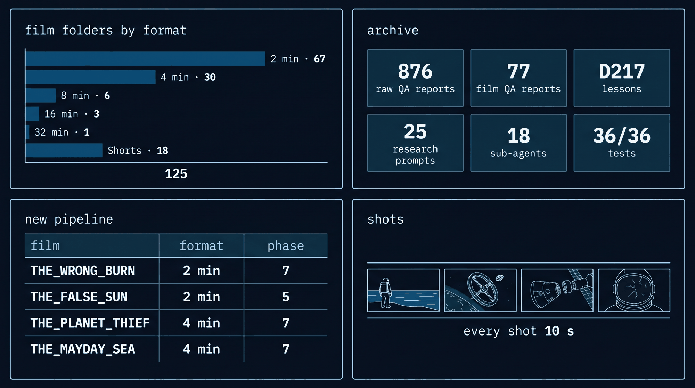</p>

<p align="center">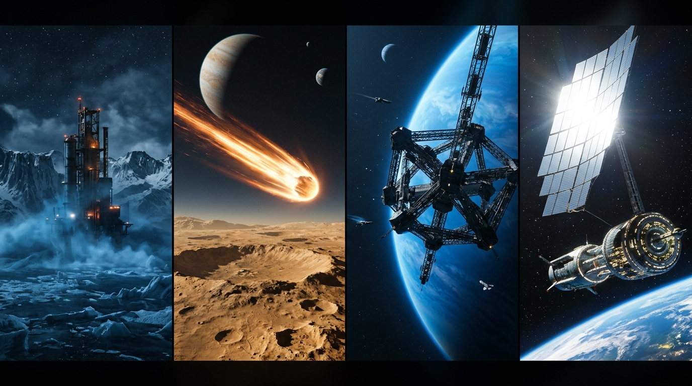</p>

### 🚀 New Agentic Pipeline Films / Yeni Hat Filmleri (4)

| Film | Format | State / Durum (22.10.2026) | Concept / Konsept | Model Voiced / Replik |
|---|---|---|---|:---:|
| **THE_MAYDAY_SEA** | Horizontal 4 min · 24 shots | 🎬 Phase 7: Flow Rendering (Owner) | Sinking hydrogen tower on an icy methane ocean world | 18 lines (model-voiced) |
| **THE_WRONG_BURN** | Horizontal 2 min · 12 shots | 🎬 Phase 7: Flow Rendering (Owner) | Atmospheric orbital deceleration failure over a desert moon | — |
| **THE_PLANET_THIEF** | Horizontal 4 min · 24 shots | 🎬 Phase 7: Flow Rendering (Owner) | Rogue megastructure harvesting an exoplanet atmosphere | — |
| **THE_FALSE_SUN** | Horizontal 2 min · 12 shots | 📄 Phase 5: Prompts ready | Artificial fusion mirror malfunction blinding an orbital colony | — |

---

### 🖥️ Horizontal Films / Yatay Filmler (107)

<details>
<summary><b>Horizontal 2 min / Yatay 2 dk (67 folders)</b></summary>

LOOK_UP · THE_ABANDONED_ARMADA · THE_AMBER_LATTICE · THE_BANDED_DEEP · THE_BENT_GRASS · THE_BLIND_RETURN · THE_BREATHING_STORM · THE_BRITTLE_EDGE · THE_BURNING_ENTRY · THE_BURNING_WORLD · THE_CANOPY_WORLD · THE_COLD_WELD · THE_CRACKED_HELMET · THE_DAWN_FRONT · THE_DEAD_APPROACH · THE_DEEP_PRESSURE · THE_DEEP_ROOT · THE_DRY_ANCHOR · THE_ETERNAL_DUSK · THE_ETERNAL_ENGINE · THE_FALSE_SUN · THE_FIRST_BREATH · THE_FORGOTTEN_ARCHITECTS · THE_GLASS_ABYSS · THE_GRAVITY_ANCHOR · THE_HEALING_GROUND · THE_HERD · THE_HOLDING_FIELD · THE_HOLLOW_COUNT · THE_HOLLOW_STATION · THE_INVERSION · THE_KALEIDA_CRASH · THE_LAST_ARCHIVE · THE_LAST_BLOOM · THE_LAST_CROSSING · THE_LAST_SHIFT · THE_LEANING_ROOM · THE_LISTENING_WORLD · THE_MAGNETIC_TIDE · THE_MIRROR_FAUNA · THE_ORPHAN_BLOOM · THE_PRESSED_FIELD · THE_PULSE · THE_REMEMBERING_DUST · THE_RESONANCE_FIELD · THE_RESONANT_STRAND · THE_RING_LIGHT · THE_RING_WALKER · THE_ROSE_COAT · THE_SHADOW_LINE · THE_SHATTERED_BREATH · THE_SILENT_EVENT_HORIZON · THE_SILENT_PERIHELION · THE_SLOW_TIDE · THE_SOLAR_MIRROR · THE_SPAGHETTI_TIDAL · THE_STARLESS_CIRCLE · THE_STATIC_SHADOW · THE_STATIC_VEIL · THE_STILL_SWARM · THE_STONE_SKY · THE_TALL_SHORE · THE_TETHERED_MASS · THE_TIDAL_HUNT · THE_UNBROKEN_CITY · THE_WRONG_BURN · WHITE_SILENCE

</details>

<details>
<summary><b>Horizontal 4 min / Yatay 4 dk (30 folders)</b></summary>

BLIND_ORBIT · GUNES_MEZARI · LOSS_OF_LIFT · LOW_POWER · THE_BLACK_CRADLE · THE_BLUE_DRIFT · THE_BORROWED_WEIGHT · THE_COLD_BURN · THE_COUNTED_RIVET · THE_COUNTED_TURN · THE_FROST_LINE · THE_GREEN_CEILING · THE_HARD_DOCK · THE_INWARD_FALL · THE_KEPT_LIGHT · THE_LOCKED_PULSE · THE_MAYDAY_SEA · THE_OPEN_CIRCUIT · THE_PAYLOAD · THE_PLANET_THIEF · THE_RISING_SNOW · THE_SIGNAL_KEEPERS · THE_SINKING_STAKE · THE_SKYLIGHT · THE_STANDING_WIRE · THE_STILL_POINT · THE_THIRD_DUNE · THE_UPHILL_DARK · THE_UPWARD_FALL · THE_WHITE_FLOOD

</details>

<details>
<summary><b>Horizontal 8 / 16 / 32 min / Yatay 8 / 16 / 32 dk (10 folders)</b></summary>

- **8 min:** BENI_HATIRLAMA · KRONOS_SON_SINYAL · SUSMAYAN_NOBETCI · THE_FALLING_WORLD · THE_LAST_TOW · THE_SLOW_RAIN
- **16 min:** THE_LAST_GATE · THE_SINKING_HARBOR · THE_STOLEN_SKY
- **32 min:** THE_FALSE_EARTH (192 clips, 50 scenes)

</details>

---

### 📱 Vertical Shorts / Dikey Filmler (18)

<details>
<summary><b>Vertical Shorts / Dikey Filmler (18 folders)</b></summary>

NINE_MINUTES · THE_BRIGHT_TETHER · THE_DULL_EDGE · THE_FIRST_MORNING · THE_HALF_SKY · THE_HEAVY_SIDE · THE_IRON_SLOPE · THE_LOW_MOON · THE_NEAR_PASS · THE_OPEN_SEAM · THE_QUIET_IMPACT · THE_SINKING_HOUR · THE_SLOW_STONE · THE_SLOW_TIDE · THE_THIN_ROOF · THE_WALKING_DAY · THE_WINTER_LINE · THE_WRONG_SHADOW

</details>

---

<p align="center"><sub>Λ · Apex AI Cinema · Hard Sci-Fi Production System</sub></p>
